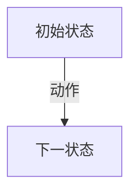

# {模块名} 产品需求说明书（PRD）— 大纲模板

| 属性 | 内容 |
|------|------|
| 文档版本 | V1.0 |
| 原型参考 | `{module}-v1.html` |
| OpenSpec 变更 | `openspec/changes/{change-name}/` |

## 修订记录

| 版本 | 日期 | 修订人 | 说明 |
|------|------|--------|------|

## 1. 概述

### 1.1 背景 / 1.2 目标 / 1.3 用户 / 1.4 系统范围

## 2. 术语

## 3. 业务流程

### 3.1 状态

### 3.2 状态流转（Mermaid 流程图：主流程 + 关闭分支）

### 3.2.1 状态自动判定（Mermaid 或优先级表）

### 3.3 主流程（步骤说明）

### 3.4 负向需求（MUST NOT）

### 3.5 分层决策表

## 4. 功能需求

### 4.0 交互与样式约定（索引 frontend-std，不写 CSS 全文）

### 4.0.1 第三方接口与实现参考

| ID | 能力 | 第三方/平台 | 接口或组件 | 用途 | 失败处理 | 实现参考 |

> 非第三方组件（附件 UI 等）可在此或字段说明中写「参考 XXX 模块的 XXX」。

### 4.x 各模块

#### 列表列定义（列表页必填）

| 列标题 | 标题提示 | 默认宽度(px) | 支持筛选 | 支持排序 | 固定位置 | 默认显示 |

#### 新增 / 编辑 / 详情 差异（表单页必填）

| 维度 | 新增 | 编辑 | 详情(view) |

#### 字段矩阵

| 分组 | 字段 | 类型 | 必填 | 可编辑 | 说明 |

## 5. 数据需求

## 6. 权限（或 Out of scope 说明）

## 7. 验收规则（表格）

本节以**表格**呈现验收规则，与 `openspec/specs/{capability-prefix}-*` 对齐。

### 7.1 M1 {模块}

| AC-ID | 场景 | 给定 | 当 | 则 | PRD | OpenSpec | 测试 |
|-------|------|------|----|----|-----|----------|------|
| AC-M1-01 | {场景名} | {前置} | {操作} | {结果} | §4.x | `{capability}` | Vitest |

### 7.11 验收追溯总表

| AC-ID | 验收需求摘要 | 场景数 | OpenSpec capability | 自动化测试 | 人工 |

> 验收表范例见示范仓 `e:\myharness`；Kit 内按本模板填写 `product/<feature>-PRD.md` §7。

## 8. 开放问题（✅ 已裁决 / ⚠️ 待确认）

## 9. 参考文档
