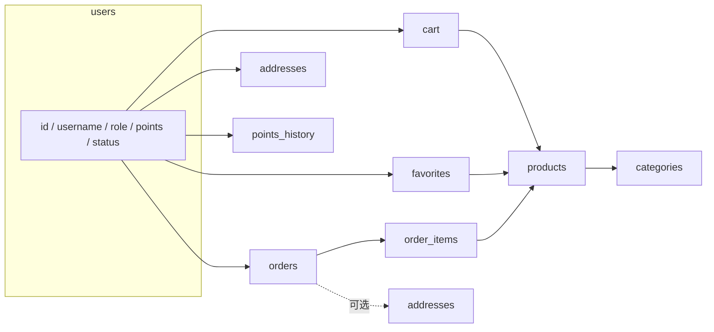
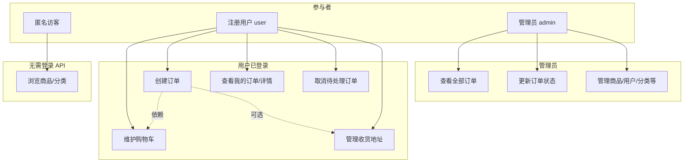
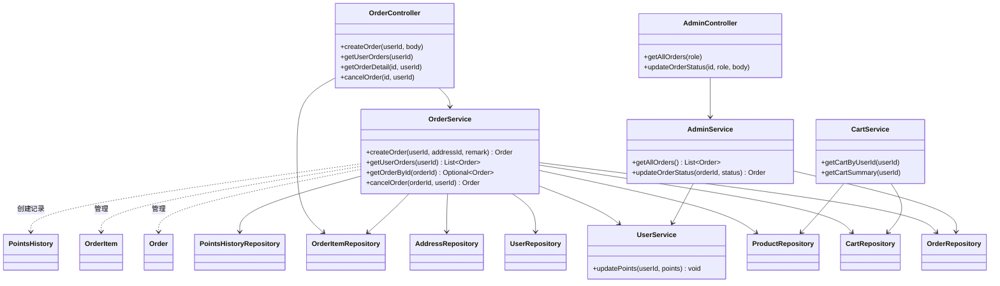
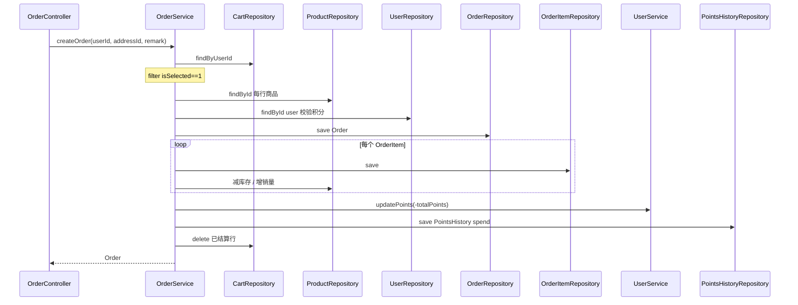
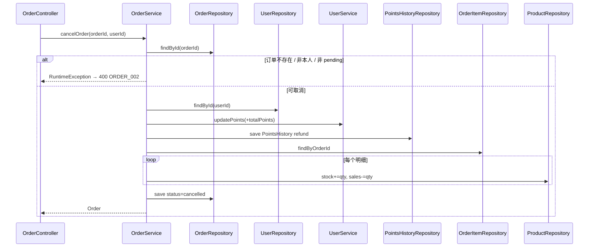
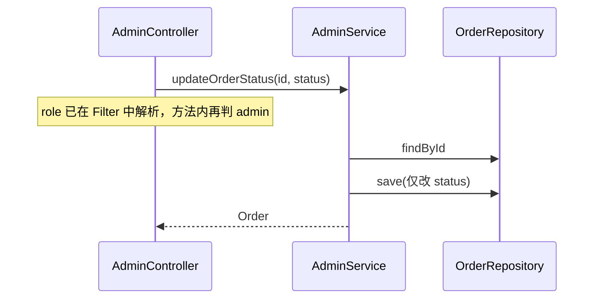
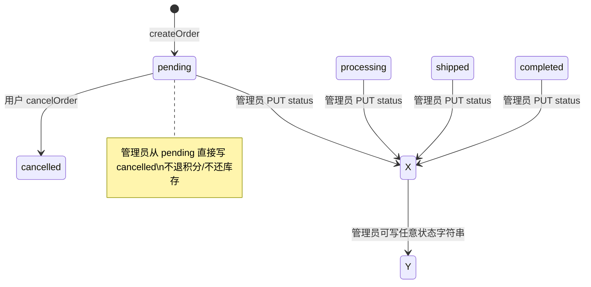

# 订单链路基线分析 · 技术设计摘录

> 基于当前代码库实体与 `OrderService` 等实现整理的**技术向**图表与说明。数据库为 **SQLite**，ORM 为 **JPA**；表间多为 **逻辑外键（Long 字段）**，一般**未声明 `@ManyToOne`/`@OneToMany`**。

**文档名说明**：按你的命名保存为 `单链路基线分析_技术.md`；若本意是「订单链」文档，可自行重命名为 `订单链路基线分析_技术.md`。

---

## 1. ER 图（实体关系）

以下为**逻辑 ER**（与 Hibernate `ddl-auto: update` 生成的表结构一致）。基数表示业务含义，非 JPA 注解级联。

```mermaid
erDiagram
    users ||--o{ orders : "user_id"
    users ||--o{ addresses : "user_id"
    users ||--o{ cart : "user_id"
    users ||--o{ favorites : "user_id"
    users ||--o{ points_history : "user_id"
    categories ||--o{ products : "category_id"
    orders ||--o| addresses : "address_id (可选)"
    orders ||--o{ order_items : "order_id"
    products ||--o{ order_items : product_id_snapshot
    products ||--o{ cart : "product_id"
    products ||--o{ favorites : "product_id"

    users {
        BIGINT id PK
        VARCHAR username UK
        VARCHAR password
        INT points
        TEXT role
        TEXT status
        DATETIME deleted_at
    }

    orders {
        BIGINT id PK
        VARCHAR order_no UK
        BIGINT user_id FK
        BIGINT address_id FK_nullable
        INT total_points
        TEXT status
        VARCHAR receiver
        VARCHAR receiver_phone
        TEXT receiver_address
        DATETIME deleted_at
    }

    order_items {
        BIGINT id PK
        BIGINT order_id FK
        BIGINT product_id FK
        VARCHAR product_name
        INT points_required
        INT quantity
        INT subtotal_points
    }

    products {
        BIGINT id PK
        BIGINT category_id FK
        INT points_required
        INT stock
        INT sales
        TEXT status
        DATETIME deleted_at
    }

    categories {
        BIGINT id PK
        VARCHAR name
        INT sort
    }

    cart {
        BIGINT id PK
        BIGINT user_id FK
        BIGINT product_id FK
        INT quantity
        INT is_selected
    }

    addresses {
        BIGINT id PK
        BIGINT user_id FK
        VARCHAR receiver
        TEXT detail_address
        DATETIME deleted_at
    }

    points_history {
        BIGINT id PK
        BIGINT user_id FK
        INT points
        TEXT type
        BIGINT related_id
        TEXT related_type
        INT balance_after
    }

    favorites {
        BIGINT id PK
        BIGINT user_id FK
        BIGINT product_id FK
    }
```

**说明**：

- 图中 `address_id FK_nullable` 表示该列**可空**：下单时可不选地址，收件信息可能为空。
- `order_items` 对 `products` 为**快照型**关联：存 `product_name`、当时 `points_required` 等，不保证与当前商品行一致。
- `cart` 表名在实体中为 `@Table(name = "cart")`（单数）。

---

## 2. 「User 图」——用户域实体关系（以 User 为中心）

侧重**谁挂在用户下**，便于权限与数据隔离讨论。



**订单链直接相关**：`users → orders → order_items`；`users → cart → products`（下单后删除对应 `cart` 行）；`users → points_history`（`related_type=order` 时与订单关联）；`addresses` 通过 `orders.address_id` 间接引用。

---

## 3. 用例图（订单链路 · 用户 / 管理员）



**与代码差异**：前端当前**未完整实现 UC3 的页面调用**（见《订单链路基线分析》业务文档）。

---

## 4. 类图（订单域 · 后端协作）

仅列出与**下单、取消、管理订单**强相关的类型及依赖方向（简化属性与方法签名）。



**分层习惯**：`Controller` → `Service` → `Repository` + `Entity`；`AuthMiddleware` 在 Filter 中注入 `userId`/`role`，不在此图中展开。

---

## 5. 时序图（下单成功路径 · 简版）



---

## 6. 接口契约表（订单链相关）

### 6.1 通用约定

| 项 | 约定 |
|----|------|
| 基础路径 | 后端 `server.servlet.context-path=/api`，故下表路径均以 **`/api` 为前缀**（与前端 `axios` `baseURL: '/api'` 一致）。 |
| 协议与编码 | `Content-Type: application/json; charset=UTF-8` |
| 鉴权 | 下表接口均**需要登录**（JWT）。请求头：`Authorization: Bearer <token>`。未携带或非法时，**过滤器**直接返回 **HTTP 401**，响应体为固定 JSON 字符串（**非** `ApiResponse` 包装），见 `AuthMiddleware`。 |
| 成功响应体 | `ApiResponse<T>`：`success`、`message`、`data`、`timestamp`；失败时另含 `error: { code, message, details }`。 |
| HTTP 状态码 | 业务成功多为 **200**；参数/业务失败多为 **400** + `success:false`；非 admin 访问 `/admin/**` 为 **403**。 |

### 6.2 订单（用户侧）

| 方法 | 路径 | 说明 | 请求体 / 路径参数 | 成功 `data` 类型 | 错误码（`error.code`） |
|------|------|------|-------------------|-------------------|-------------------------|
| `POST` | `/orders` | 创建订单 | JSON：`addressId`（可选，Long）、`remark`（可选，String） | `Order` 实体 | `ORDER_001`（创建失败，message 为服务端异常信息，如购物车无选中、库存不足、积分不足等） |
| `GET` | `/orders` | 我的订单列表 | Query：**可选** `status`（`pending`/`processing`/`shipped`/`completed`/`cancelled`）；不传或空则全量（与改前一致） | `Order[]` | `ORDER_002`（其它异常）；非法 `status` → **`ORDER_004`**（400） |
| `GET` | `/orders/{id}` | 订单详情 | `id`：Long | `{ order: Order, orderItems: OrderItem[] }` | `ORDER_002`（不存在 / 无权 / 其它异常） |
| `PUT` | `/orders/{id}/cancel` | 取消订单 | `id`：Long | `Order` | `ORDER_002`（非本人、非 pending 等） |
| `PUT` | `/orders/{id}/confirm-receipt` | 用户确认收货 | `id`：Long；body 可为空 | `Order` | **`ORDER_003`**（非本人、非 `shipped`、订单不存在/已删等）；**幂等**：已是 `completed` 则 200 不改动无副作用 |

**`Order` 响应主要字段（实体直出）**：`id`、`orderNo`、`userId`、`addressId`、`totalPoints`、`status`、`receiver`、`receiverPhone`、`receiverAddress`、`remark`、`createdAt`、`updatedAt`、`deletedAt` 等。

**`OrderItem` 主要字段**：`id`、`orderId`、`productId`、`productName`、`productImage`、`pointsRequired`、`quantity`、`subtotalPoints`、`createdAt`。

### 6.3 购物车（与下单前置）

| 方法 | 路径 | 说明 | 请求体 / 路径参数 | 成功 `data` | 错误码 |
|------|------|------|-------------------|-------------|--------|
| `GET` | `/cart` | 购物车 + 汇总 | 无 | `{ cartItems: Cart[], summary: { totalCount, selectedCount, totalPoints, totalQuantity } }` | `CART_001` |
| `POST` | `/cart` | 加购 | JSON：`productId`（必填）、`quantity`（可选，默认 1） | `Cart` | `CART_001` |
| `PUT` | `/cart/{id}/selection` | 勾选/取消勾选 | `id`：购物车行 ID；JSON：`isSelected`（**0 或 1**）；**校验** `cart.userId == token.userId` | `Cart` | `CART_001` |
| `PUT` | `/cart/{id}` | 改数量 | `id`：购物车行 ID；JSON：`quantity`（必填，≤0 时删除该行） | `Cart` 或 `null`（已删除） | `CART_001` |
| `DELETE` | `/cart/{id}` | 删除一行 | `id` | `null` | `CART_001` |
| `DELETE` | `/cart/clear` | 清空当前用户购物车 | 无 | `null` | `CART_001` |

**`Cart` 主要字段**：`id`、`userId`、`productId`、`quantity`、`isSelected`（0/1）、`createdAt`、`updatedAt`。

> **说明**：当前代码**未提供**单独修改 `isSelected` 的接口；勾选状态仅影响服务端 `createOrder` 筛选逻辑。

### 6.4 订单（管理员）

| 方法 | 路径 | 说明 | 请求体 / 路径参数 | 成功 `data` | 错误码 |
|------|------|------|-------------------|-------------|--------|
| `GET` | `/admin/orders` | 全量订单列表 | 无；需 `role=admin` | `Order[]` | `AUTH_004`（403，非管理员） |
| `PUT` | `/admin/orders/{id}/status` | 更新订单状态 | `id`：Long；JSON：`{ "status": "<字符串>" }`（由 `Map<String,String>` 绑定，**键名必须为 `status`**） | `Order` | `AUTH_004`（403）/ `SYS_001`（400，如订单不存在等） |

**状态值**：代码**未枚举校验**；实体注释含 `pending`、`processing`、`shipped`、`completed`、`cancelled` 等，管理员可传入任意字符串。

### 6.5 与订单链相关的只读接口（鉴权仍按过滤器）

以下在**实现购物车/下单页**时常一并调用，契约摘录便于联调：

| 方法 | 路径 | 鉴权 | 说明 |
|------|------|------|------|
| `GET` | `/products`、`/products/{id}` | **匿名可访问**（白名单） | 商品列表/详情 |
| `GET` | `/categories` | **匿名可访问** | 分类列表 |
| `GET` | `/addresses`（若项目已实现） | 需登录 | 收货地址列表（以 `AddressController` 为准） |

地址类接口以实际 `AddressController` 为准，此处不展开字段。

---

## 7. 性能与并发

### 7.1 运行时与存储基线

| 维度 | 当前实现要点 |
|------|----------------|
| 数据库 | **SQLite** 单文件（`jdbc:sqlite:./database/mall.db`），嵌入式、零配置。 |
| ORM | **Hibernate / JPA**，`ddl-auto: update`（开发便利，生产需评估）。 |
| 连接池 | Spring Boot 默认 **HikariCP**（未在 `application.yml` 自定义池大小）。 |
| 事务 | `OrderService.createOrder` / `cancelOrder` 等方法使用 **`@Transactional`**，下单在同一事务内完成订单、明细、库存、积分、流水、删购物车。 |

### 7.2 SQLite 与写入并发

- SQLite 典型模型为 **单写者（one writer）** 与多读；高并发写（多订单同时提交）时可能出现 **`database is locked`** 或写队列延迟。
- 事务隔离级别未在配置中显式指定，依赖 JDBC/SQLite 默认与 Hibernate 行为；**未使用**显式 `SERIALIZABLE` 或 SQLite `BEGIN IMMEDIATE` 等强化语句。
- **不适合**作为多实例横向扩展下的共享数据库；若仅单机演示或低并发内网，通常可接受。

### 7.3 库存与积分竞态（超卖 / 重复扣减）

| 场景 | 行为 | 风险 |
|------|------|------|
| 两笔订单同时扣同一 `Product` 库存 | `createOrder` 内为「读库存 → 判断 → 写库存」的**非原子**多步操作，无 `SELECT ... FOR UPDATE`、无乐观版本号字段。 | 并发下可能 **超卖**（库存扣成负数取决于校验是否仅依赖应用层与 DB 约束；当前实体无 `CHECK(stock>=0)` 时更易出现）。 |
| 同一用户快速双击「提交订单」 | 依赖前端防抖与后端幂等；当前 **无订单幂等键**（如 clientToken），可能产生重复订单（若两次请求均通过校验）。 | 重复下单、重复扣积分。 |
| 积分扣减 | `UserService.updatePoints` 为 **读改写**；高并发下依赖 DB 与事务隔离，SQLite 写锁可序列化部分冲突，但仍非业务级「余额校验+扣减」原子原语。 | 极端并发下需 **数据库约束或单行原子更新**（如 `UPDATE users SET points = points - ? WHERE id=? AND points>=?`）。 |

### 7.4 读路径与 N+1

- `GET /orders` 返回订单列表，**不附带** `orderItems`，列表场景较轻量；可选 **`?status=`** 时仅返回该状态（白名单枚举，非法值 400/`ORDER_004`）。
- `GET /orders/{id}` 单独查 `Order` 再查 `OrderItemRepository.findByOrderId`，为 **2 次查询**，可接受；若未来列表要带明细，需注意 **N+1** 问题（批量 `IN` 查询或 DTO 聚合）。

### 7.5 管理端与批量

- `GET /admin/orders` 使用 `orderRepository.findAll()`，订单量大时 **全表加载**，无分页、无筛选，存在 **内存与响应时间** 压力。
- 管理员改状态为单条 `PUT`，无批量接口。

### 7.6 小结与改进方向（工程建议）

1. **库存**：对热点 SKU 使用 **乐观锁**（`version` 列）或 **单条 SQL 条件更新** 扣库存；或引入支持行锁更强的数据库。  
2. **下单幂等**：客户端生成 `Idempotency-Key` 或服务端基于 `userId+购物车快照 hash` 去重。  
3. **SQLite 上限**：若并发上升，迁移至 **PostgreSQL/MySQL** 并配置连接池与隔离策略。  
4. **管理列表**：分页（`Pageable`）、按状态/时间索引查询。

---

## 8. 分析项索引（与下文附录对应）

| 编号 | 分析项 | 所在章节 |
|------|--------|----------|
| A | 接口契约表 | **§6**（基础）、**§11**（补全与错误码汇总） |
| B | 序列图细化 | **§5**（下单）、**§9**（取消、管理员、异常） |
| C | 状态机形式化 | **§10** |
| D | 数据字典 | **§15** |
| E | 前端缺口 | **§14** |
| F | 安全 | **§13** |
| G | 性能与并发 | **§7**（基线）、**§12**（要点清单） |
| H | 与业务文档对齐 | **§17** |

---

## 9. 时序图（补充：取消订单、管理员改状态、异常边界）

### 9.1 用户取消订单（`PUT /orders/{id}/cancel`）

仅当订单 `status == pending` 时进入完整退款与还库存路径。



### 9.2 管理员更新订单状态（`PUT /admin/orders/{id}/status`）

**不**触发积分回退或库存恢复（与 §10 状态机「用户取消」语义不同）。



### 9.3 创建订单失败与事务边界

`OrderService.createOrder` 带 `@Transactional`：任一步未捕获的运行时异常将导致**整单回滚**（已写入的 Order/OrderItem/库存/积分等一并撤销），前提是异常在事务提交前抛出且未被吞掉。

| 失败点 | 典型异常信息 | 是否回滚同一事务 |
|--------|----------------|------------------|
| 无选中购物车行 | 购物车中没有选中的商品 | 是（尚未持久化订单） |
| 库存不足 | 商品 xxx 库存不足 | 是 |
| 积分不足 | 积分不足，当前积分… | 是 |
| 地址不存在 | 收货地址不存在（addressId 非空时） | 是 |

---

## 10. 状态机（订单）

### 10.1 代码中出现的 `status` 取值（实体注释）

`pending`、`processing`、`shipped`、`completed`、`cancelled`（用户取消路径写入）。

### 10.2 形式化迁移表（与实现对照）

| 当前状态 | 事件 | 执行者 | 下一状态 | 库存/积分副作用（代码实际） |
|----------|------|--------|----------|-----------------------------|
| *（无）* | `createOrder` 成功 | 系统 | `pending` | 扣库存、扣积分、写 spend 流水、删购物车行 |
| `pending` | `cancelOrder`（用户） | 用户 | `cancelled` | 退积分、写 refund 流水、还库存 |
| `pending` | `PUT /admin/.../status` | 管理员 | **任意字符串** | **无**自动退补 |
| `processing` / `shipped` / `completed` | `cancelOrder` | 用户 | （不允许） | 抛错：只能取消 pending |
| 任意 | `PUT /admin/.../status` | 管理员 | **任意字符串** | 无校验；若设为 `cancelled` **不等于**用户取消，**不退款不还库存** |

### 10.3 状态图（含实现风险标注）



---

## 11. API 契约（补全：认证、地址、积分流水 + 错误码汇总）

### 11.1 认证（联调订单前必用）

| 方法 | 路径 | 鉴权 | 请求体 | 成功 `data` |
|------|------|------|--------|-------------|
| `POST` | `/auth/login` | 匿名 | `{ "username", "password" }` | `{ token, userType, userId, username, expiresIn }` |

**说明**：`userType` 与 JWT 内 `role` 同源，前端常映射为 `userInfo.role`。

| `error.code` | 场景 |
|--------------|------|
| `USER_001` | 用户名为空、密码错误、账户禁用等（`AuthService` 抛 `RuntimeException`） |
| `SYS_001` | 登录未预期异常 |

### 11.2 收货地址（下单选地址）

| 方法 | 路径 | 请求体 / 参数 | 成功 `data` | `error.code` |
|------|------|---------------|-------------|--------------|
| `GET` | `/addresses` | 无 | `Address[]` | `SYS_001` |
| `POST` | `/addresses` | `Address` 实体 JSON（服务端补 `userId`） | `Address` | `SYS_001` |
| `PUT` | `/addresses/{id}` | `id` + `Address` | `Address` | `SYS_001` |
| `DELETE` | `/addresses/{id}` | `id` | `null` | `SYS_001` |

`AddressService` 对 `update`/`delete` 校验归属，**跨用户改地址**会失败；但 **`POST /orders` 未校验 `addressId` 是否属于当前用户**（见 §13）。

### 11.3 积分流水

| 方法 | 路径 | 查询参数 | 成功 `data` |
|------|------|----------|-------------|
| `GET` | `/points/history` | `type`（可选） | `PointsHistory[]` |

### 11.4 全局错误码汇总（订单链相关）

| Code | HTTP | 含义（典型） |
|------|------|----------------|
| `AUTH_001` | 401 | 过滤器返回的未登录（响应体非标准 `ApiResponse`，见 §6） |
| `AUTH_004` | 403 | 非管理员访问 `/admin/**` |
| `ORDER_001` | 400 | 创建订单失败 |
| `ORDER_002` | 400 | 查询/取消订单失败（不含列表非法 `status`，见 `ORDER_004`） |
| `ORDER_003` | 400 | **确认收货**失败（非本人、非 `shipped`、订单不存在等） |
| `ORDER_004` | 400 | **订单列表**非法 `status` 查询参数 |
| `CART_001` | 400 | 购物车操作失败 |
| `USER_001` | 400 | 登录参数/认证失败 |
| `USER_002` | 400 | 用户信息相关（`UserController`） |
| `PROD_001` | 400 | 商品不存在（详情） |
| `SYS_001` | 400/500 | 通用业务/系统异常（地址、管理员服务、积分流水等） |

---

## 12. 并发（要点清单，与 §7 配套）

| 编号 | 要点 | 详见 |
|------|------|------|
| C-1 | SQLite **单写**、高并发写可能锁等待或 `database is locked` | §7.2 |
| C-2 | 库存扣减 **非原子条件更新**，存在超卖窗口 | §7.3 |
| C-3 | 积分 **读改写**，无 `WHERE points >= ?` 单条更新 | §7.3 |
| C-4 | **无下单幂等**，重复提交可能双单 | §7.3、§7.6 |
| C-5 | 管理端 `findAll` 订单 **无分页** | §7.5 |
| C-6 | 同一用户多终端同时登录：**无**会话互斥，共享同一用户积分池 | 实现层未限制 |

**设计改进**：与 §7.6 一致；生产环境优先 **条件更新库存** + **幂等键** + **分页**。

---

## 13. 安全（威胁与当前实现）

| ID | 风险 | 说明 | 严重程度（相对） |
|----|------|------|------------------|
| S-1 | **JWT 密钥** | `application.yml` 明文 `jwt.secret`，泄露可伪造 token | 高（生产） |
| S-2 | **购物车行越权** | `PUT/DELETE /cart/{id}` **未校验** `cart.userId == token.userId` | 高 |
| S-3 | **下单地址冒用** | `POST /orders` 的 `addressId` **未校验**归属用户 | 中 |
| S-4 | **管理员状态滥用** | 任意状态字符串；`cancelled` **无**配套退款/还库存 | 中 |
| S-5 | **Token 存储** | 前端 `localStorage`，XSS 可窃取 | 中 |
| S-6 | **CORS** | `allowedOriginPattern("*")` + `allowCredentials(true)`，环境不当有 CSRF/跨域风险 | 中（视部署） |
| S-7 | **商品列表匿名** | `/products`、`/categories` 白名单可未登录访问 | 低（业务可选） |
| S-8 | **密码存储** | 部分种子用户 **明文密码**（`AuthService` 兼容明文比对） | 高（生产） |

**缓解方向**：校验购物车/地址资源归属；管理员状态机与退款策略；密钥外置；HTTPS；HttpOnly Cookie 或短期 Token；CORS 收紧。

---

## 14. 前端缺口（订单链）

| ID | 缺口 | 位置 / 现象 |
|----|------|----------------|
| F-1 | **无创建订单调用** | `orderApi.createOrder` 已封装，**无任何页面调用** |
| F-2 | ~~**结算路由错误**~~ **已修** | 已增加 **`/orders/create`** 静态路由（位于 **`/orders/:id`** 之前），不再把 `create` 当作订单 ID |
| F-3 | ~~**无「下单页」**~~ **已修** | `OrderCreate.vue`：地址（可选）、备注、`POST /orders`，成功后跳转订单详情 |
| F-4 | ~~购物车勾选无效~~ **已修** | `PUT /cart/{id}/selection` + `Cart.vue` 勾选联动 `loadCart`；`PUT/DELETE /cart/{id}` 改数量/删除仍**未**校验归属（见 S-2） |
| F-5 | **管理端订单无 `cancelled` 选项** | `AdminOrders.vue` 下拉里无「已取消」，与后端可能状态不一致 |
| F-6 | **路由与 API 对照** | 见下表 |

**关键路由与 API**

| 路由 | 组件 | 调用的订单/购物车 API |
|------|------|------------------------|
| `/cart` | `Cart.vue` | `GET /cart`、`PUT .../selection`、`PUT/DELETE /cart/*`；结算 **未** 调 `POST /orders` |
| `/orders` | `Orders.vue` | `GET /orders`（**可选** `?status=` 筛选）、`PUT .../cancel`、`PUT .../confirm-receipt`（列表行 `shipped`） |
| `/orders/:id` | `OrderDetail.vue` | `GET /orders/:id`；`pending` 取消、`shipped` 确认收货（`:id` 须为数字） |
| `/orders/create` | `OrderCreate.vue` | `GET /cart`、`GET /addresses`、`POST /orders` |

---

## 15. 数据字典（订单链相关表）

以下为 **JPA 实体 → 表** 字段说明；SQLite 类型由 Hibernate 映射，此处以业务类型描述。

### 15.1 `users`

| 字段 | 类型 | 约束/默认 | 说明 |
|------|------|-----------|------|
| id | BIGINT | PK，自增 | |
| username | VARCHAR | UK，非空 | |
| password | VARCHAR | 非空 | 可能为 BCrypt 或明文（演示） |
| email, phone | VARCHAR | 可空 | |
| points | INT | 默认 0 | 当前积分余额 |
| role | TEXT | 默认 `user` | `user` / `admin` |
| department, position, avatar | VARCHAR | 可空 | |
| status | TEXT | 默认 `active` | `active` / `inactive` |
| last_login_at | DATETIME | 可空 | |
| created_at, updated_at, deleted_at | DATETIME | 可空 | 软删 |

### 15.2 `orders`

| 字段 | 类型 | 说明 |
|------|------|------|
| id | BIGINT PK | |
| order_no | VARCHAR UK | 默认 `ORD`+时间戳 |
| user_id | BIGINT FK 逻辑 | |
| address_id | BIGINT 可空 | |
| total_points | INT 非空 | |
| status | TEXT | 默认 `pending` |
| receiver, receiver_phone | VARCHAR | 快照 |
| receiver_address | TEXT | 快照 |
| remark | TEXT | |
| created_at, updated_at, deleted_at | DATETIME | |

### 15.3 `order_items`

| 字段 | 类型 | 说明 |
|------|------|------|
| id | BIGINT PK | |
| order_id | BIGINT | |
| product_id | BIGINT | 关联商品（快照场景） |
| product_name | VARCHAR | 快照 |
| product_image | VARCHAR | 快照 |
| points_required | INT | 单件积分（快照） |
| quantity | INT | |
| subtotal_points | INT | 行小计积分 |
| created_at | DATETIME | |

### 15.4 `cart`

| 字段 | 类型 | 说明 |
|------|------|------|
| id | BIGINT PK | |
| user_id | BIGINT | |
| product_id | BIGINT | `(user_id,product_id)` 唯一 |
| quantity | INT | 默认 1 |
| is_selected | INT | 0/1 |
| created_at, updated_at | DATETIME | |

### 15.5 `products`（订单校验用）

| 字段 | 类型 | 说明 |
|------|------|------|
| id | BIGINT PK | |
| name | VARCHAR | |
| description, specifications | TEXT | 规格常为 JSON 字符串 |
| price | DOUBLE | 积分商城可为 0 |
| points_required | INT | 兑换所需积分 |
| stock, warning_stock | INT | |
| images | TEXT | JSON 数组字符串 |
| status | TEXT | `active`/`inactive` |
| category_id | BIGINT | |
| sales, views, favorites | INT | |
| exchange_rules | TEXT | |
| sort | INT | |
| created_at, updated_at, deleted_at | DATETIME | |

### 15.6 `addresses`

| 字段 | 类型 | 说明 |
|------|------|------|
| id | BIGINT PK | |
| user_id | BIGINT | |
| receiver, phone | VARCHAR | |
| province, city, district | VARCHAR | |
| detail_address | TEXT | |
| postal_code | VARCHAR | |
| is_default | INT | 0/1 |
| created_at, updated_at, deleted_at | DATETIME | |

### 15.7 `points_history`

| 字段 | 类型 | 说明 |
|------|------|------|
| id | BIGINT PK | |
| user_id | BIGINT | |
| points | INT | 正增负减 |
| type | VARCHAR | 如 `earn`/`spend`/`adjust`/`refund` |
| description | TEXT | |
| related_id | BIGINT | 如订单 id |
| related_type | VARCHAR | 如 `order` |
| balance_after | INT | 操作后余额 |
| created_at | DATETIME | |

### 15.8 `categories` / `favorites`

- **`categories`**：`id`, `name`, `description`, `sort`, `icon`, `status`, `created_at`, `updated_at`, `deleted_at`。
- **`favorites`**：`id`, `user_id`, `product_id`, `tag`, `created_at`；唯一 `(user_id, product_id)`。

---

## 16. 测试矩阵（订单链 · 建议用例）

以下为**黑盒/接口级**建议矩阵，便于手工或自动化回归；预期以当前代码为准。

### 16.1 创建订单 `POST /orders`

| # | 场景 | 前置条件 | 预期 |
|---|------|----------|------|
| T1 | 正常下单 | 购物车有 `isSelected=1`、积分够、库存够 | 200，`data` 为 Order；库存减、积分减、流水 spend、购物车行删除 |
| T2 | 无选中商品 | 购物车全未选或为空 | 400，`ORDER_001`，消息含「没有选中」 |
| T3 | 积分不足 | 积分 < 应付 | 400 |
| T4 | 库存不足 | 任一行 qty > stock | 400 |
| T5 | 地址不存在 | `addressId` 指向无效 id | 400 |
| T6 | 未登录 | 无 Authorization | **401**（过滤器） |

### 16.2 取消 `PUT /orders/{id}/cancel`

| # | 场景 | 预期 |
|---|------|------|
| T7 | pending 取消 | 200；积分退回、refund 流水、库存恢复、`cancelled` |
| T8 | 非 pending 取消 | 400 |
| T9 | 他人订单 id | 400，无权 |

### 16.3 查询 `GET /orders`、`GET /orders/{id}`

| # | 场景 | 预期 |
|---|------|------|
| T10 | 列表仅本人 | 仅当前 userId 订单 |
| T11 | 详情本人 | 200 + orderItems |
| T12 | 详情他人 | 400，无权查看 |

### 16.4 管理员 `GET/PUT /admin/orders*`

| # | 场景 | 预期 |
|---|------|------|
| T13 | admin 拉列表 | 200 |
| T14 | user 调 admin | 403，`AUTH_004` |
| T15 | 改状态为任意字符串 | 200（实现未校验） |

### 16.5 购物车（安全）

| # | 场景 | 预期（当前实现风险） |
|---|------|------------------------|
| T16 | 用他人 `cartId` 改数量 | 可能 **200**（**应失败**）— 记录为缺陷 |

### 16.6 并发（可选压测）

| # | 场景 | 观察 |
|---|------|------|
| T17 | 两请求同时扣同一 SKU | 是否出现负库存或超卖 |
| T18 | 双重点击提交 | 是否双单 |

---

## 17. 与《订单链路基线分析》对齐

- **业务向**流程、角色、异常分支：见 **[订单链路基线分析.md](订单链路基线分析.md)**。
- **技术向** ER/类图/接口/并发/安全/数据/测试：本文 **§1–§16**。
- 变更代码时建议同步检查：**§14 前端缺口**、**§13 安全**、**§16 测试矩阵**。

---

*图表为静态代码快照生成；若实体或方法重命名，请同步更新本文档。*
