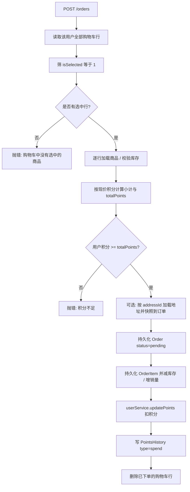
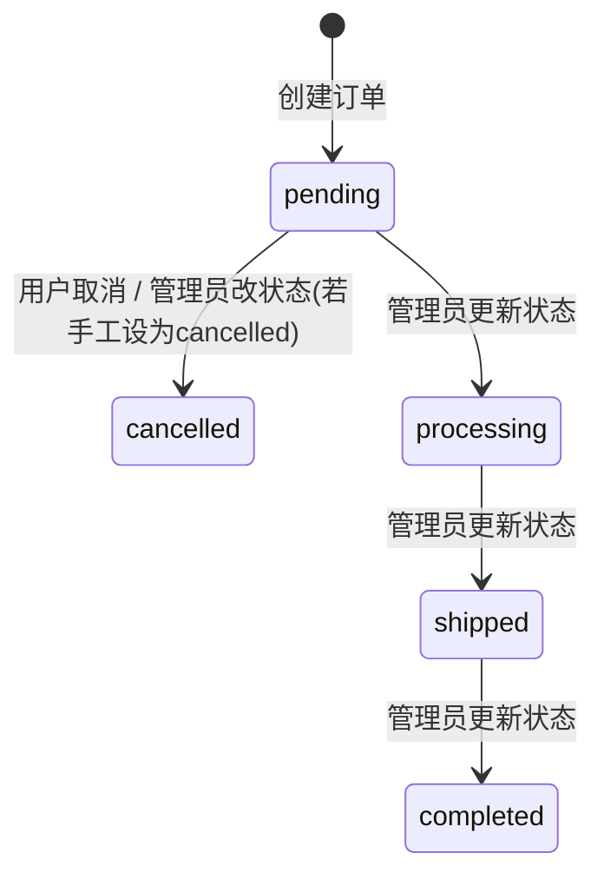

# 订单链路基线分析

> 基于当前仓库后端 `OrderService` / `OrderController`、购物车、积分与管理员接口，以及前端购物车、订单相关页面的**代码事实**梳理。

---

## 1. 用户下单主流程

### 1.1 后端主路径（唯一实现入口）

下单由 **`POST /orders`** 触发（需登录，JWT 解析出 `userId`），核心逻辑在 `OrderService.createOrder(userId, addressId, remark)`，整体在**同一事务**内完成（类上无 `@Transactional`，方法带 `@Transactional`）。

**步骤要点**：

| 步骤 | 行为 |
|------|------|
| 购物车来源 | `cartRepository.findByUserId(userId)`，仅 **`isSelected == 1`** 的行参与结算 |
| 金额 | 使用**当前** `Product.pointsRequired × quantity` 汇总为 `totalPoints` |
| 库存 | 下单前校验 `product.stock >= quantity`，通过后逐项扣减库存、增加 `sales` |
| 积分 | `userService.updatePoints(userId, -totalPoints)`；并插入 `PointsHistory`（`type=spend`，`relatedType=order`） |
| 购物车 | 对参与结算的 `Cart` 行执行 **`delete`**，非仅清空选中状态 |
| 地址 | `addressId` **可为 null**；若提供则按 id 查 `Address`，把收件人/电话/拼接地址写入订单；**未校验地址是否属于当前 userId** |

### 1.2 前端与后端的衔接现状

- 前端 `orderApi.createOrder(data)` 已封装 **`POST /orders`**，但**当前没有任何页面在流程中调用该方法**。
- 购物车「结算」按钮执行 `this.$router.push('/orders/create')`。路由表中**不存在** `/orders/create` 专用页；该路径会被 **`/orders/:id`** 匹配，`id` 为字符串 **`create`**，进入 `OrderDetail` 后请求 **`GET /orders/create`**，与后端数字 ID 语义不符，**无法完成下单**。
- 购物车勾选框 `toggleSelect` 注释为「需要后端支持，暂时跳过」，变更后仅 `loadCart()`，**无法切换 `isSelected`**；默认新建购物车行 `isSelected=1`，故在「全选默认」前提下后端仍能拉到选中行，但**无法部分勾选结算**。

**结论**：下单**后端链路完整**；**前端从购物车到创建订单的闭环未接通**，需补「下单页/弹窗」调用 `createOrder` 并传 `addressId`、`remark`，或修正路由与结算逻辑。

---

## 2. 订单状态与状态流转

### 2.1 实体约定

`Order` 字段 `status` 注释约定：`pending`、`processing`、`shipped`、`completed`、`cancelled`。

### 2.2 用户侧流转

| 操作 | 条件 | 结果状态 |
|------|------|----------|
| 创建订单 | 成功 | `pending` |
| 取消订单 | `PUT /orders/{id}/cancel`，且订单属于当前用户 | 仅当 **`status == pending`** 时设为 `cancelled`；否则抛错 |

非 `pending` 状态下，用户**不能**通过当前接口取消。

### 2.3 管理员侧流转

| 操作 | 接口 | 实现 |
|------|------|------|
| 改状态 | `PUT /admin/orders/{id}/status`，body `{ "status": "..." }` | `AdminService.updateOrderStatus`：**直接** `order.setStatus(status)` 后保存 |

**特点**：

- **无状态机校验**：可从任意状态改为任意字符串（包括 `cancelled`），与业务语义可能不一致。
- **与用户取消不同**：管理员把订单改为 `cancelled` **不会**自动退积分、**不会**恢复库存（用户取消才会做这两件事）。

### 2.4 建议理解的「基线」流转图（与代码意图对齐）

前端展示文案与用户侧一致（`Orders.vue` / `OrderDetail.vue`）：`pending`～`completed` 及 `cancelled`；管理台 `AdminOrders.vue` 下拉里**未包含** `cancelled`，但若后端已是 `cancelled`，选项可能无法高亮匹配（显示为原始字符串或依赖浏览器行为）。

---

## 3. 与订单相关的库存、积分、购物车、权限关系

### 3.1 库存

| 环节 | 行为 |
|------|------|
| 加购 `CartService.addToCart` | 校验**当时** `stock >= quantity`；已存在同商品则**累加数量**，累加后**未再次**校验总数量与库存关系 |
| 修改购物车数量 `updateQuantity` | **不校验**库存 |
| 下单 `createOrder` | 再次按行校验库存；成功则 `stock -= quantity`，`sales += quantity` |
| 用户取消 `cancelOrder` | `stock += quantity`，`sales = max(0, sales - quantity)` |

**未校验**：商品是否下架/删除（`Product` 仅用 `findById`，未过滤 `status`/`deletedAt`）；若 DB 中仍存在已下架商品，仍可能下单（取决于数据是否可被 `findById` 查到）。

### 3.2 积分

| 环节 | 行为 |
|------|------|
| 下单 | `updatePoints(userId, -totalPoints)` + `PointsHistory`（`spend`，`balanceAfter` 使用扣减前积分计算） |
| 用户取消 | `updatePoints(userId, +order.totalPoints)` + `PointsHistory`（`refund`） |
| 管理员改积分 | `AdminService.updateUserPoints` 调 `userService.updatePoints`，**与订单无自动关联** |

`UserService.updatePoints` 为简单 `points + delta`，**无负数下限校验**（依赖下单前一次性校验）。

### 3.3 购物车

- 下单**仅消费「当前用户 + isSelected=1」**的购物车行；成功后**物理删除**这些行。
- 未选中行保留；用户侧**无 API 修改 `isSelected`**（前端勾选无效），因此「部分结算」依赖手工删行或默认全选。

### 3.4 权限

| 能力 | 权限 |
|------|------|
| `POST /orders`、`GET /orders`、`GET /orders/{id}`、`PUT /orders/{id}/cancel` | 需 JWT；订单详情与取消会校验 **`order.userId` 与 token 内 `userId`** |
| `GET /admin/orders`、`PUT /admin/orders/{id}/status` | 需 JWT 且 **`role == admin`** |

**额外风险**：`CartController` 的 `PUT /cart/{id}`、`DELETE /cart/{id}` **未传入或校验 `userId` 与购物车行归属**，存在**水平越权**修改/删除他人购物车项的理论可能（若猜到 `cart.id`）。

---

## 4. 用户侧与管理员侧各自可做的操作

### 4.1 用户侧（API + 前端）

| 操作 | 后端 | 前端页面 |
|------|------|----------|
| 查看我的订单列表 | `GET /orders` | `Orders.vue` |
| 查看订单详情（含明细） | `GET /orders/{id}` | `OrderDetail.vue`（`:id` 为数字订单 ID） |
| 创建订单 | `POST /orders` body：`addressId`（可选）、`remark`（可选） | **无调用** |
| 取消订单 | `PUT /orders/{id}/cancel`，仅 `pending` | `Orders.vue` 对 `pending` 显示取消按钮 |

购物车：`GET/POST/PUT/DELETE /cart`、`DELETE /cart/clear` — `Cart.vue` 使用列表与改数量/删除；**结算跳转错误**，见上文。

### 4.2 管理员侧

| 操作 | 后端 | 前端 |
|------|------|------|
| 查看全部订单 | `GET /admin/orders` | `admin/Orders.vue` |
| 更新订单状态 | `PUT /admin/orders/{id}/status` | 下拉里选状态触发 |

管理员**没有**单独的「订单详情」接口；若需明细，当前代码库未提供专门 admin 详情 API（仅用户侧按 `userId` 校验的详情接口）。

---

## 5. 当前实现中的异常分支和限制条件

### 5.1 下单失败类（`createOrder` 抛错）

- 购物车无 **`isSelected == 1`** 的行。
- 商品不存在（`findById` 失败）。
- **库存不足**（按行提示商品名）。
- **积分不足**（提示当前积分与所需积分）。
- `addressId` 非 null 但地址不存在。

成功路径依赖事务：任一步异常应整体回滚（注意：若 `PointsHistory` 等与订单同一事务，需保证未单独提交；当前为默认 Spring 事务代理，方法级 `@Transactional` 一般可覆盖）。

### 5.2 取消订单失败类（`cancelOrder`）

- 订单不存在。
- **非订单所属用户**。
- **状态不是 `pending`**（不允许取消）。

成功时：退积分、写退款流水、恢复库存与销量、状态 `cancelled`。

### 5.3 业务与工程限制（基线风险清单）

1. **前端下单未打通**：结算进入 `/orders/create` 与路由设计冲突，**无创建订单 UI**。
2. **购物车勾选**：后端无更新 `isSelected` 接口；前端勾选无效，无法按勾选 subset 结算（除非全部默认选中或删行）。
3. **地址归属**：下单未校验 `Address.userId`，存在**错用他人地址 ID** 的风险（若知晓 ID）。
4. **商品状态**：下单未强制 `status=active` / 未删除，可能与「下架不可买」预期不符。
5. **购物车数量与库存**：加购合并、改数量时**可能超过实时库存**，仅在下单时暴露错误。
6. **并发超卖**：无乐观/悲观锁，高并发下 SQLite + 读改写库存可能**超卖**。
7. **管理员改状态**：无合法状态集合校验；设为 `cancelled` **不退款不退库存**，与用户取消语义不一致。
8. **购物车 API 越权**：按 `cartId` 更新/删除未绑定当前用户。
9. **订单列表**：用户侧 `getUserOrders` 使用 `deletedAtIsNull`；**取消订单不写 `deletedAt`**，取消单仍在列表中显示为 `cancelled`（符合一般「已取消可见」；若期望隐藏需改查询）。

---

*本文档随代码变更可能失效；以 `backend` / `frontend` 实际实现为准。*
