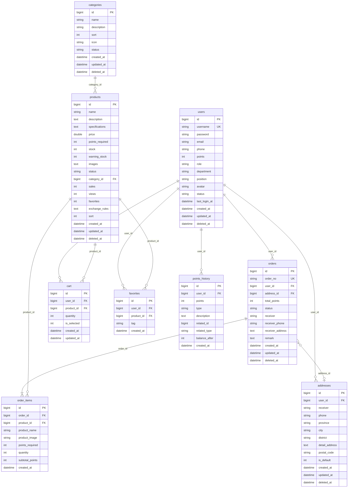
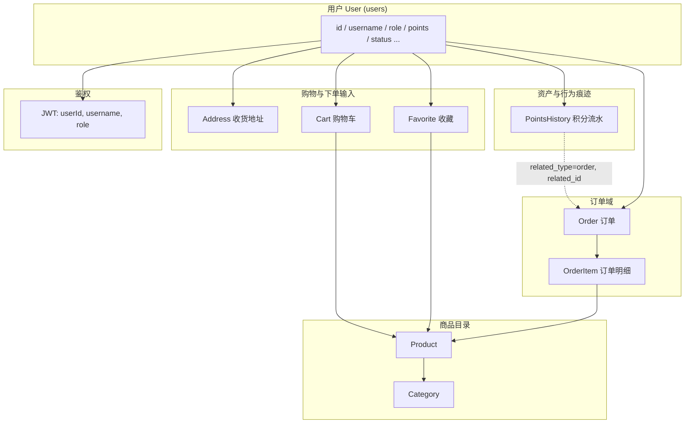
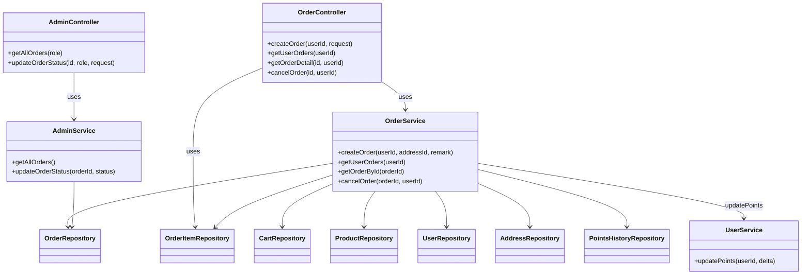
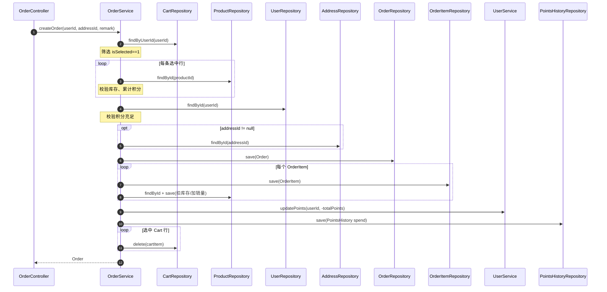
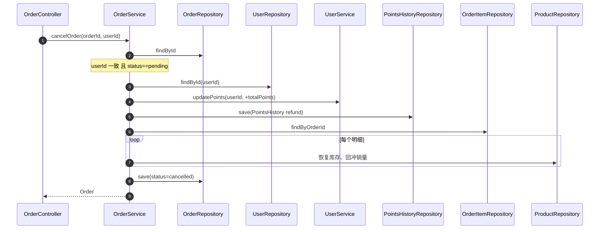
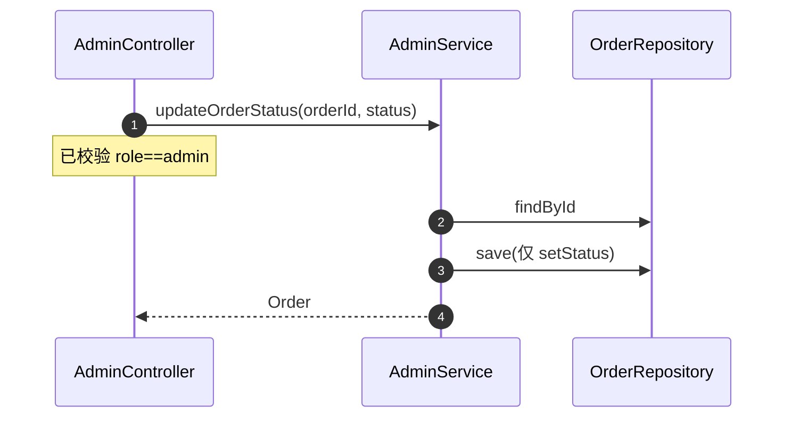
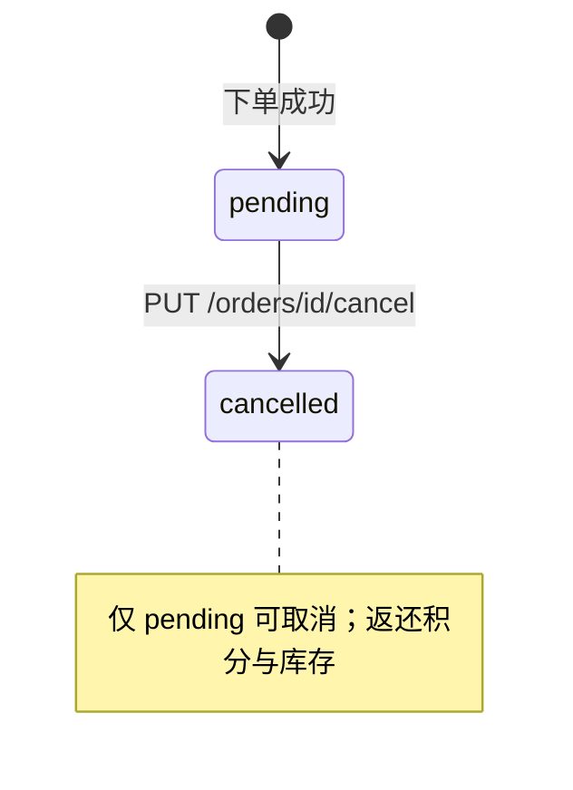
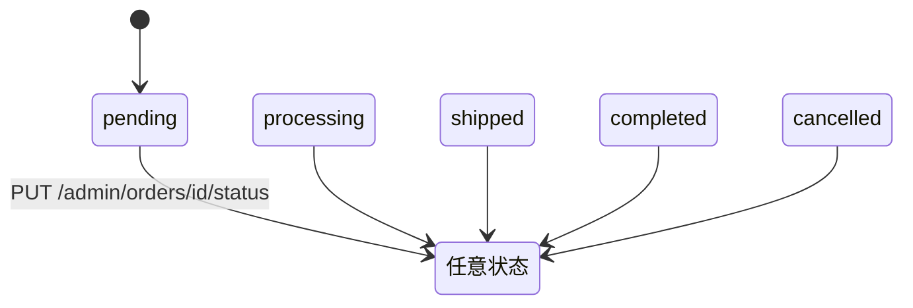

# 订单链路基线分析 · 技术设计摘录

> 基于当前 `backend` 实体与订单相关服务整理：**ER 图**、**用户域视图**、**订单链路类图（核心）**，并列出**可继续分析项**供确认。  
> 表间关系在 JPA 中多为 **显式 `Long` 外键字段**，未使用 `@ManyToOne` 关联对象。

---

## 1. ER 图（订单链路及相关表）

说明：`orders.address_id` → `addresses.id`；`orders.user_id` → `users.id`；`order_items` 同时引用 `orders` 与 `products`（逻辑上）；`cart` / `favorites` / `points_history` 与用户、商品关联。

**库表约束补充（来自实体注解）**

| 表 | 约束 |
|----|------|
| `cart` | `UNIQUE(user_id, product_id)` |
| `favorites` | `UNIQUE(user_id, product_id)` |
| `orders` | `order_no` 唯一 |

---

## 2. User 图（用户域：账户、资产与订单侧关系）

从「用户」视角聚合与订单链路相关的实体（非 UML 标准，便于读需求/评审）。

**订单创建时的数据流（逻辑）**

`Cart(is_selected=1)` → 读 `Product` 计价/扣库存 → 写 `Order` + `OrderItem` → `User.points` 扣减 → `PointsHistory(spend)` → 删除对应 `Cart` 行。

---

## 3. 类图（订单链路 · 后端核心）

仅包含与下单、查单、取消、管理端改状态直接相关的类及主要依赖（省略 DTO、通用 `ApiResponse`）。

**分层说明（与当前工程一致）**

| 层 | 职责 |
|----|------|
| `controller` | 解析 JWT 注入的 `RequestAttribute`、组装 `ApiResponse`、异常码 |
| `service` | 事务边界、业务规则（如下单校验、取消退款） |
| `repository` | Spring Data JPA 访问 |

---

## 4. 订单状态（与实体字段对齐）

`Order.status`：`pending` | `processing` | `shipped` | `completed` | `cancelled`（字符串，无 DB 枚举约束）。

管理员 `AdminService.updateOrderStatus` 未校验状态机；用户取消仅允许 `pending` → `cancelled`（见业务分析文档）。

---

## 5. 扩展分析（A～H）

以下按此前清单 **A～H 已全部展开**；若与代码不一致，以代码为准。

### 5.1 A — 时序图

**约定**：`context-path` 为 `/api`，下列路径均为相对该前缀（完整示例：`http://localhost:8080/api/orders`）。`OrderService.createOrder` / `cancelOrder`、`AdminService.updateOrderStatus` 方法级 **`@Transactional`**。

#### A1 创建订单 `POST /orders`

#### A2 用户取消 `PUT /orders/{id}/cancel`

#### A3 管理员改状态 `PUT /admin/orders/{id}/status`

---

### 5.2 B — 状态机图

**实现语义**：用户取消与管理员改状态 **两条路径互不统一**（代码未强制同一状态机）。

#### B1 用户侧（唯一合法迁移）

非 `pending` 状态用户 **不能** 调用取消接口成功。

#### B2 管理员侧（实现为「任意字符串」）

**与代码一致的事实**：`AdminService.updateOrderStatus` **不** 校验目标状态是否属于白名单、**不** 禁止从 `cancelled` 迁出、**不** 同步库存/积分。

#### B3 目标态（建议约束，非当前实现）

若产品要求「管理员可代客关闭订单」，需在服务层约定：例如仅允许  
`pending → processing → shipped → completed`，`cancelled` 为终态；管理员是否可写 `cancelled` 需单独产品规则。

---

### 5.3 C — API 契约表（订单链路）

**通用响应**（成功）：`ApiResponse<T>`：`success`、`message`、`data`、`timestamp`。  
**失败**：`success: false`，`error.code` / `error.message`（与健康检查等少数 Filter 直写 JSON 格式可能略有差异）。

**鉴权**：除登录与公开商品/分类等外，需 `Authorization: Bearer <token>`。白名单见 `AuthMiddleware.EXCLUDED_PATHS`（`/orders`、`/admin/*` **不在** 白名单）。

| 方法 | 路径（相对 `/api`） | 角色 | 请求体 / 参数 | 成功 `data` 概要 | 典型错误码 |
|------|---------------------|------|----------------|-------------------|------------|
| POST | `/orders` | 登录用户 | `{ "addressId"?: number, "remark"?: string }` | `Order` | `ORDER_001` |
| GET | `/orders` | 登录用户 | — | `Order[]` | `ORDER_002` |
| GET | `/orders/{id}` | 登录用户 | — | `{ order, orderItems }` | `ORDER_002` |
| PUT | `/orders/{id}/cancel` | 登录用户 | — | `Order` | `ORDER_002` |
| GET | `/admin/orders` | admin | — | `Order[]` | `AUTH_004` |
| PUT | `/admin/orders/{id}/status` | admin | `{ "status": string }` | `Order` | `AUTH_004` / `SYS_001` |

**与 `spec/AI2AI/协议和数据.md` 的关系**：本表为订单子集快照；**以后者及 Controller 源码为单一事实来源时需人工对齐**。

---

### 5.4 D — 并发与一致性

| 场景 | 当前行为 | 风险 |
|------|----------|------|
| 两用户同时买同一 SKU | 各事务内 `read` 库存后扣减 | **超卖**：后提交事务可能把库存扣成负数（若未二次校验） |
| 同用户重复点击下单 | 两次 `POST /orders` | 可能生成两单；**无客户端幂等键 / 无服务端幂等** |
| 积分扣减 | `UserService.updatePoints` 读改写 | 并发下可能 **积分透支**（依赖 DB 隔离级别与事务顺序） |
| 事务边界 | `createOrder` / `cancelOrder` 单方法事务 | 与库存、积分、流水、购物车删除 **同事务**，单请求内一致；跨请求无保证 |

**SQLite**：默认隔离级别与 Hibernate 配置以运行环境为准；高并发场景建议：库存字段 **乐观锁（@Version）** 或 **扣减 SQL 带 `WHERE stock >= ?`**、订单 **业务幂等号**。

---

### 5.5 E — 安全模型（订单相关）

| 点 | 现状 | 建议方向 |
|----|------|----------|
| 登录态 | JWT Filter 校验后注入 `userId`、`role` | — |
| 用户读单 | `getOrderDetail` 校验 `order.userId == userId` | 已防跨用户读 |
| 下单地址 | `createOrder` 仅 `addressRepository.findById`，**未校验 `address.userId == userId`** | 应校验归属 |
| 购物车 `PUT/DELETE /cart/{id}` | **未校验 cart 行属于当前 userId** | 存在 **IDOR**：猜 id 可能改他人购物车 |
| 管理员接口 | 各方法内 `role.equals("admin")` | 普通用户 JWT 无法调用，逻辑成立 |
| 管理员改状态 | 无审计、无二次认证 | 视合规要求补强 |

---

### 5.6 F — 前端订单页与契约差异

| 项 | 现状 |
|----|------|
| 路由 | `router/index.js` **无** `/orders/create`；`Cart.vue` 结算 `push('/orders/create')` → **无匹配路由**（通常落 404 或空白） |
| 下单 API | `orderApi.createOrder` 已封装，**无页面调用** |
| 购物车勾选 | `toggleSelect` 未调后端；**无** 更新 `isSelected` 的 API | 
| 订单列表/详情/取消 | `Orders.vue`、`OrderDetail.vue` 与后端路径一致 |
| 管理端订单 | `admin/Orders.vue` 使用 `GET/PUT /admin/orders...`，与后端一致 |

---

### 5.7 G — 数据字典（订单链路核心表）

类型以 JPA/SQLite 习惯写法描述；`ddl-auto: update` 由 Hibernate 维护表结构。

**`orders`**

| 字段 | 类型 | 约束/说明 |
|------|------|-----------|
| id | INTEGER | PK，自增 |
| order_no | TEXT | UNIQUE，非空；`@PrePersist` 可生成 ORD+时间戳 |
| user_id | INTEGER | 非空，逻辑 FK → users.id |
| address_id | INTEGER | 可空，逻辑 FK → addresses.id |
| total_points | INTEGER | 非空 |
| status | TEXT | 默认 pending |
| receiver / receiver_phone | TEXT | 快照 |
| receiver_address | TEXT | 快照 |
| remark | TEXT | |
| created_at / updated_at / deleted_at | TEXT/DATETIME | 软删 |

**`order_items`**

| 字段 | 类型 | 约束/说明 |
|------|------|-----------|
| id | INTEGER | PK |
| order_id | INTEGER | 非空 |
| product_id | INTEGER | 非空 |
| product_name / product_image | TEXT | 快照 |
| points_required / quantity / subtotal_points | INTEGER | 非空 |
| created_at | | |

**`points_history`（订单相关）**

| 字段 | 说明 |
|------|------|
| type | 下单 spend / 取消 refund 等 |
| related_id + related_type | 如 order + 订单 id |
| balance_after | 操作后积分余额 |

**索引建议（若数据量增大）**：`orders(user_id, deleted_at)`、`order_items(order_id)`、`points_history(user_id, created_at)`；SQLite 由 DBA/迁移脚本添加，当前工程未显式声明。

---

### 5.8 H — 测试用例矩阵（订单）

**图例**：✓ 应成功，✗ 应失败，— 依赖实现/未定义。

| # | 场景 | 角色 | 前置 | 预期 |
|---|------|------|------|------|
| H1 | POST /orders，购物车有选中、积分够 | user | isSelected=1 | ✓ 建单、扣库存积分、删购物车行 |
| H2 | POST /orders，无选中商品 | user | 全未选或空车 | ✗ ORDER_001 |
| H3 | POST /orders，库存不足 | user | quantity > stock | ✗ |
| H4 | POST /orders，积分不足 | user | points < total | ✗ |
| H5 | POST /orders，addressId 指向他人地址 | user | 恶意 id | 当前实现可能 **✓（漏洞）**；应 ✗ |
| H6 | PUT /orders/{id}/cancel，pending | 本人 | status=pending | ✓ 退款、还库存 |
| H7 | PUT /orders/{id}/cancel，processing | 本人 | | ✗ |
| H8 | GET /orders/{id}，他人订单 id | user | | ✗ |
| H9 | PUT /admin/orders/{id}/status | admin | 任意字符串 | ✓（当前实现） |
| H10 | PUT /admin/orders/{id}/status | 普通用户 | | ✗ AUTH_004 |
| H11 | 并发两单抢最后 1 件库存 | 两用户 | | 可能 **超卖**（待测） |

---

## 6. 文档与代码同步说明

- 实体字段以 `backend/src/main/java/com/example/mall/entity/*.java` 为准；若代码变更，请同步更新本文 **§1 ER** 与 **§3 类图**。
- Mermaid 在支持 Mermaid 的 Markdown 预览器（如 VS Code 插件、GitHub）中可直接渲染。
