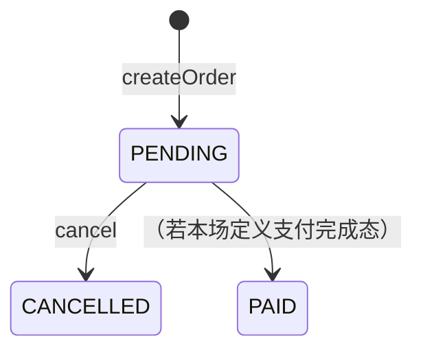

# YWPT Workshop Kit Implementation Plan

> **For agentic workers:** REQUIRED SUB-SKILL: Use superpowers:subagent-driven-development (recommended) or superpowers:executing-plans to implement this plan task-by-task. Steps use checkbox (`- [ ]`) syntax for tracking.

**Goal:** Build the reusable workshop kit (skeleton, prep cards, gates, coverage scope, canary stubs, curriculum shells) so a 3h dual-track run of「存量扫描→下单结算交付→课件沉淀」can be executed against this mall repo.

**Architecture:** Track 0 materials live under `workshop/prep/`; live-run ledger is `workshop/compass.md`; a small Node validator enforces kit completeness before any dry-run. Application checkout code is **not** rewritten in this plan—only scoped, instrumented, and scaffolded for the live P3–P5 stages.

**Tech Stack:** Markdown kit · Node.js validator · GitNexus CLI · Spring Boot 3 / SQLite / Vue 3 + Vite (existing mall) · JaCoCo include whitelist (to be added when tests land in live run)

**Spec:** `docs/superpowers/specs/2026-08-04-ywpt-workshop-pipeline-design.md`

---

## File structure (lock-in)

| Path | Responsibility |
|------|----------------|
| `workshop/README.md` | Learner entry: how to start, roles, timebox |
| `workshop/compass.md` | Live-run ledger template (P0–P6 sections) |
| `workshop/scripts/validate-kit.mjs` | Fails if required kit files/sections missing |
| `workshop/prep/env-setup.md` | One-shot env: JDK/Node/ports/DB/index |
| `workshop/prep/prompt-cards/P0.md` … `P6.md` | Main prompt per stage |
| `workshop/prep/prompt-cards/P0-recovery.md` … (or single `recovery-cards.md`) | Recovery prompts on gate reject |
| `workshop/prep/gate-scripts/P0.md` … `P5.md` | PO questions + pass/fail (P6 has no product gate) |
| `workshop/prep/coverage-scope.md` | Frozen core-package whitelist for 95% |
| `workshop/prep/canary/README.md` | How to use reference branch / sample report |
| `workshop/prep/canary/sample-quality-report.md` | Example passing report shape |
| `workshop/prep/gitnexus-queries.md` | P0 query playbook |
| `workshop/baseline/.gitkeep` | Filled during live P0 |
| `workshop/product/order.html` | Prototype skeleton for P1 |
| `workshop/product/PRD-order-checkout.md` | PRD skeleton for P1 |
| `workshop/quality/.gitkeep` | Live P4 outputs |
| `workshop/delivery/.gitkeep` | Live P5 outputs |
| `workshop/curriculum/01`…`06` | Shells filled after first dry-run / P6 |
| `workshop/prep/jacoco-include.txt` | Paths for future JaCoCo `<includes>` |

Out of scope for this plan’s commits: implementing missing checkout behaviors, adding full test suites, creating canary git branch content (document the branch convention only; branch may be created empty/annotated).

---

### Task 1: Kit validator (TDD) + directory skeleton

**Files:**
- Create: `workshop/scripts/validate-kit.mjs`
- Create: `workshop/scripts/fixtures/minimal-kit-manifest.json` (expected paths list used by tests/docs)
- Create: placeholder dirs via files listed in manifest (created in later tasks; this task only validator + failing first)

- [ ] **Step 1: Write the failing validator and a tiny self-check**

Create `workshop/scripts/validate-kit.mjs`:

```js
#!/usr/bin/env node
import fs from 'node:fs';
import path from 'node:path';
import { fileURLToPath } from 'node:url';

const __dirname = path.dirname(fileURLToPath(import.meta.url));
const root = path.resolve(__dirname, '..');

const REQUIRED = [
  'README.md',
  'compass.md',
  'prep/env-setup.md',
  'prep/coverage-scope.md',
  'prep/gitnexus-queries.md',
  'prep/canary/README.md',
  'prep/canary/sample-quality-report.md',
  'prep/jacoco-include.txt',
  'prep/prompt-cards/P0.md',
  'prep/prompt-cards/P1.md',
  'prep/prompt-cards/P2.md',
  'prep/prompt-cards/P3.md',
  'prep/prompt-cards/P4.md',
  'prep/prompt-cards/P5.md',
  'prep/prompt-cards/P6.md',
  'prep/prompt-cards/recovery-cards.md',
  'prep/gate-scripts/P0.md',
  'prep/gate-scripts/P1.md',
  'prep/gate-scripts/P2.md',
  'prep/gate-scripts/P3.md',
  'prep/gate-scripts/P4.md',
  'prep/gate-scripts/P5.md',
  'product/order.html',
  'product/PRD-order-checkout.md',
  'curriculum/01-讲师手册.md',
  'curriculum/02-学员手册.md',
  'curriculum/03-提示词卡册.md',
  'curriculum/04-评分表.md',
  'curriculum/05-示范产物索引.md',
  'curriculum/06-踩坑-playbook.md',
];

const COMPASS_MARKERS = ['## P0', '## P1', '## P2', '## P3', '## P4', '## P5', '## P6'];

function main() {
  const missing = [];
  for (const rel of REQUIRED) {
    const abs = path.join(root, rel);
    if (!fs.existsSync(abs)) missing.push(rel);
  }
  const compassPath = path.join(root, 'compass.md');
  let compassIssues = [];
  if (fs.existsSync(compassPath)) {
    const text = fs.readFileSync(compassPath, 'utf8');
    for (const m of COMPASS_MARKERS) {
      if (!text.includes(m)) compassIssues.push(`compass.md missing marker: ${m}`);
    }
    for (const field of ['目标', 'Prompt 卡', '人闸结论', '耗时', 'degraded']) {
      if (!text.includes(field)) compassIssues.push(`compass.md missing field hint: ${field}`);
    }
  }
  if (missing.length || compassIssues.length) {
    console.error('validate-kit FAILED');
    for (const m of missing) console.error('  missing:', m);
    for (const c of compassIssues) console.error(' ', c);
    process.exit(1);
  }
  console.log('validate-kit OK', REQUIRED.length, 'files');
}

main();
```

Also write `workshop/scripts/fixtures/minimal-kit-manifest.json` as a copy of the `REQUIRED` array for documentation:

```json
{
  "required": [
    "README.md",
    "compass.md",
    "prep/env-setup.md",
    "prep/coverage-scope.md",
    "prep/gitnexus-queries.md",
    "prep/canary/README.md",
    "prep/canary/sample-quality-report.md",
    "prep/jacoco-include.txt",
    "prep/prompt-cards/P0.md",
    "prep/prompt-cards/P1.md",
    "prep/prompt-cards/P2.md",
    "prep/prompt-cards/P3.md",
    "prep/prompt-cards/P4.md",
    "prep/prompt-cards/P5.md",
    "prep/prompt-cards/P6.md",
    "prep/prompt-cards/recovery-cards.md",
    "prep/gate-scripts/P0.md",
    "prep/gate-scripts/P1.md",
    "prep/gate-scripts/P2.md",
    "prep/gate-scripts/P3.md",
    "prep/gate-scripts/P4.md",
    "prep/gate-scripts/P5.md",
    "product/order.html",
    "product/PRD-order-checkout.md",
    "curriculum/01-讲师手册.md",
    "curriculum/02-学员手册.md",
    "curriculum/03-提示词卡册.md",
    "curriculum/04-评分表.md",
    "curriculum/05-示范产物索引.md",
    "curriculum/06-踩坑-playbook.md"
  ]
}
```

- [ ] **Step 2: Run validator — expect FAIL**

Run:

```bash
node workshop/scripts/validate-kit.mjs
```

Expected: exit code 1, many `missing:` lines.

- [ ] **Step 3: Commit validator only**

```bash
git add workshop/scripts/validate-kit.mjs workshop/scripts/fixtures/minimal-kit-manifest.json
git commit -m "test: add workshop kit structure validator (failing until kit lands)"
```

---

### Task 2: `compass.md` template + empty stage dirs

**Files:**
- Create: `workshop/compass.md`
- Create: `workshop/baseline/.gitkeep`
- Create: `workshop/quality/.gitkeep`
- Create: `workshop/delivery/.gitkeep`

- [ ] **Step 1: Write `workshop/compass.md`**

```markdown
# Workshop Compass（现场主账）

> 每段限时结束后立即填写。禁止事后补造人闸结论。

**场次:**  
**学员:**  
**产品方:**  
**教练:**  
**开始时间:**  

---

## P0 存量扫描与基线

- **目标:**
- **Prompt 卡:** P0
- **关键指令 / 工具摘要:**
- **产物路径:** `workshop/baseline/`
- **人闸结论:** 通过 / 打回 — 
- **耗时（分钟）:**
- **踩坑:**
- **degraded:** false / true — 原因:

## P1 原型与 PRD

- **目标:**
- **Prompt 卡:** P1
- **关键指令 / 工具摘要:**
- **产物路径:** `workshop/product/order.html`, `workshop/product/PRD-order-checkout.md`
- **人闸结论:** 通过 / 打回 —
- **耗时（分钟）:**
- **踩坑:**
- **degraded:** false / true — 原因:

## P2 OpenSpec 对抗收敛

- **目标:**
- **Prompt 卡:** P2
- **关键指令 / 工具摘要:**
- **产物路径:** `openspec/changes/<change>/`
- **人闸结论:** 通过 / 打回 —
- **耗时（分钟）:**
- **踩坑:**
- **degraded:** false / true — 原因:

## P3 编码与审查

- **目标:**
- **Prompt 卡:** P3
- **关键指令 / 工具摘要:**
- **产物路径:**（列出改动模块）
- **人闸结论:** 通过 / 打回 —
- **耗时（分钟）:**
- **踩坑:**
- **degraded:** false / true — 原因:

## P4 质量门禁

- **目标:** 核心包行&分支 ≥ 95%；最小测试集绿
- **Prompt 卡:** P4
- **关键指令 / 工具摘要:**
- **产物路径:** `workshop/quality/`
- **人闸结论:** 通过 / 打回 —
- **耗时（分钟）:**
- **踩坑:**
- **degraded:** false / true — 原因:

## P5 启服走查

- **目标:**
- **Prompt 卡:** P5
- **关键指令 / 工具摘要:**
- **产物路径:** `workshop/delivery/walkthrough-log.md`
- **人闸结论:** 通过 / 打回 —
- **耗时（分钟）:**
- **踩坑:**
- **degraded:** false / true — 原因:

## P6 罗盘收口与课件

- **目标:** compass 齐全；curriculum 待办可执行
- **Prompt 卡:** P6
- **关键指令 / 工具摘要:**
- **产物路径:** `workshop/curriculum/`
- **人闸结论:** n/a（教练勾选完整度）
- **耗时（分钟）:**
- **踩坑:**
- **degraded:** false / true — 原因:

---

## 场次总结

- **模块是否可演示:**
- **质量是否宣称通过:**（若 degraded 则必须写否）
- **课件六件套状态:**
```

- [ ] **Step 2: Add `.gitkeep` files for live output dirs**

Create empty `workshop/baseline/.gitkeep`, `workshop/quality/.gitkeep`, `workshop/delivery/.gitkeep`.

- [ ] **Step 3: Commit**

```bash
git add workshop/compass.md workshop/baseline/.gitkeep workshop/quality/.gitkeep workshop/delivery/.gitkeep
git commit -m "docs: add workshop compass template and live output dirs"
```

---

### Task 3: Freeze coverage scope + JaCoCo include list

**Files:**
- Create: `workshop/prep/coverage-scope.md`
- Create: `workshop/prep/jacoco-include.txt`

- [ ] **Step 1: Write frozen whitelist**

`workshop/prep/coverage-scope.md`:

```markdown
# 下单结算核心包覆盖率 Scope（冻结）

**硬门禁:** 行覆盖率 ≥ 95% 且 分支覆盖率 ≥ 95%（仅本白名单分母）。  
**非目标:** 管理端、商品浏览、收藏、非结算 User API 等不计入分母。

## 后端（JaCoCo include）

| 类型 | 路径 / 类 |
|------|-----------|
| Service | `com.example.mall.service.OrderService` |
| Service | `com.example.mall.service.CartService`（仅与下单选中项协作的方法；整类计入以简化工具配置） |
| Controller | `com.example.mall.controller.OrderController` |
| Controller | `com.example.mall.controller.CartController` |

> 若 P0 缺口分析证明结算逻辑落在其他类，**先改本文件并人闸**，再改 `jacoco-include.txt`。

## 前端（后续 Istanbul/Vitest include，本场可先人工审查）

| 模块 | 路径 |
|------|------|
| API | `frontend/src/api/order.js` |
| API | `frontend/src/api/cart.js` |
| View | `frontend/src/views/Cart.vue`（结算入口） |
| View | `frontend/src/views/Orders.vue` |
| View | `frontend/src/views/OrderDetail.vue` |

## 必须绿的最小用例（与 spec §4 对齐）

1. UT: 下单成功  
2. UT: 库存不足  
3. UT: 积分不足  
4. UT: 地址缺失 / 无效  
5. API: POST `/api/orders` 契约  
6. API: 未鉴权失败  
7. 集成: 扣库存 + 扣积分一致性  
8. E2E: 购物车→下单→订单列表  
9. E2E: 取消或异常路径一条  
```

`workshop/prep/jacoco-include.txt`:

```text
**/OrderService.class
**/CartService.class
**/OrderController.class
**/CartController.class
```

- [ ] **Step 2: Commit**

```bash
git add workshop/prep/coverage-scope.md workshop/prep/jacoco-include.txt
git commit -m "docs: freeze checkout core-package coverage whitelist"
```

---

### Task 4: Env setup + GitNexus query playbook

**Files:**
- Create: `workshop/prep/env-setup.md`
- Create: `workshop/prep/gitnexus-queries.md`

- [ ] **Step 1: Write env-setup**

`workshop/prep/env-setup.md`:

```markdown
# Track 0 · 环境预装（课前）

## 必备

- JDK 21+
- Maven 3.9+
- Node.js 18+（建议 20 LTS）
- Git

## 仓库依赖

```bash
# 后端
cd backend
mvn -q -DskipTests package

# 前端
cd ../frontend
npm install
```

## 端口

| 服务 | 端口 | 说明 |
|------|------|------|
| Backend | `8080` | `context-path=/api` → `http://localhost:8080/api` |
| Frontend | Vite 默认 `5173` | 见 `frontend/vite.config.js` |

## 数据库

- SQLite 文件：`backend/database/mall.db`（首次启动由应用初始化）
- 勿提交本地脏库到课件主分支

## GitNexus（本仓）

当前 MCP 可能仍索引其他仓。课前必须对本仓建索引：

```bash
# 在仓库根目录
npx gitnexus analyze
# 或已安装全局：gitnexus analyze
node .gitnexus/run.cjs status
```

用 MCP `list_repos` 确认出现本仓库名后再开课。

## 冒烟

```bash
# 终端 1
cd backend && mvn spring-boot:run

# 终端 2
cd frontend && npm run dev
```

浏览器打开前端，登录种子账号（见 `DataInitializer`），确认购物车页可打开。

## Kit 校验

```bash
node workshop/scripts/validate-kit.mjs
```

Expected: `validate-kit OK`（全部物料提交后）。
```

- [ ] **Step 2: Write GitNexus queries**

`workshop/prep/gitnexus-queries.md`:

```markdown
# P0 · GitNexus 查询剧本

在 Cursor 中对**本仓**依次执行（MCP 或自然语言均可）：

1. `list_repos` — 确认当前索引是 `ywpt_workshop_test`（或本机目录名），不是无关仓。  
2. `query`：`order checkout createOrder cart points stock`  
   - goal: find order creation and cart-to-order flow  
3. `context`：`OrderService`  
4. `context`：`CartService`  
5. `route_map` 或 `query`：`/orders`  
6. `impact`：`OrderService` direction=`upstream` — 记录谁依赖结算  

将结论写入 `workshop/baseline/project-baseline.md`：

- 技术栈表  
- 业务模块列表  
- 下单结算缺口（半成品：已有 createOrder，缺什么状态/异常/前端闭环）  
- 建议的 OpenSpec change 名（如 `order-checkout-hardening`）  
```

- [ ] **Step 3: Commit**

```bash
git add workshop/prep/env-setup.md workshop/prep/gitnexus-queries.md
git commit -m "docs: add workshop env setup and GitNexus P0 query playbook"
```

---

### Task 5: Prompt cards (P0–P6) + recovery cards

**Files:**
- Create: `workshop/prep/prompt-cards/P0.md` … `P6.md`
- Create: `workshop/prep/prompt-cards/recovery-cards.md`

- [ ] **Step 1: Write all main cards**

`P0.md`:

```markdown
# Prompt 卡 P0 · 存量扫描（≤15min）

你是执行学员。请对本福利商城仓库：

1. 确认 GitNexus 索引指向本仓（见 `workshop/prep/gitnexus-queries.md`）。  
2. 按查询剧本收集：技术栈、模块、订单/购物车/积分相关流程与缺口。  
3. 写入 `workshop/baseline/project-baseline.md`。  
4. 能确定的项回填 `.cursor/rules/00-project-context.mdc` 的 TODO。  
5. 暂停，交给产品方按 `workshop/prep/gate-scripts/P0.md` 开闸。  

约束：不改业务代码；不扩展到支付/优惠券。
```

`P1.md`:

```markdown
# Prompt 卡 P1 · 原型与 PRD（≤30min）

输入需求（仅此一句）：「开发下单结算」。

1. 基于 `workshop/product/order.html` 骨架，用视觉伴随或 HTML 直接补全结算页关键区块（地址、商品摘要、积分合计、提交、错误态）。  
2. 产品方确认原型后，按 `.cursor/skills/prd-prototype-authoring` 完善 `workshop/product/PRD-order-checkout.md`：状态机、负向需求、验收表覆盖中等 MVP（闭环+状态+库存/积分异常）。  
3. 可选：跑 prd-prototype-review 快检，问题记入 compass。  
4. 开闸：`gate-scripts/P1.md`。  

约束：不做管理端；不做真实支付。
```

`P2.md`:

```markdown
# Prompt 卡 P2 · OpenSpec + 对抗（≤30min）

1. 使用 `/opsx-propose`（或 openspec-propose skill）基于已确认 PRD 生成 change（建议名见 baseline）。  
2. 对抗分析固定 5 题并改生成物：  
   - 范围是否偷渡优惠券/支付/售后？  
   - 订单状态优先级是否唯一？  
   - 库存与积分并发/超扣如何处理？  
   - 未登录/鉴权失败契约？  
   - 验收是否可测（对应 coverage-scope 最小集）？  
3. 收敛 `proposal.md` / `specs/` / `design.md` / `tasks.md`，删除不可控任务。  
4. 开闸：`gate-scripts/P2.md`。  
```

`P3.md`:

```markdown
# Prompt 卡 P3 · 实现与审查（≤45min）

1. 仅实现 tasks.md 内任务；遵循 OpenSpec apply / codeflow-code-testing。  
2. 每完成切片：更新 tasks 状态；用 GitNexus `detect_changes` 或 `impact` 看爆炸半径。  
3. 对照 `workshop/prep/canary/` 差异，禁止无关重构。  
4. 产出简短 review 要点写入 compass P3。  
5. 开闸：`gate-scripts/P3.md`（按 AC 口述抽查，不替代走查）。  
```

`P4.md`:

```markdown
# Prompt 卡 P4 · 质量（≤35min）

1. 严格按 `workshop/prep/coverage-scope.md` 白名单配置覆盖率。  
2. 用 TDD 补齐最小用例集（UT/API/集成/E2E）。  
3. 目标：核心包行&分支 ≥ 95%。达不到则 `degraded=true`，**禁止**写「质量通过」。  
4. 输出 `workshop/quality/quality-summary.md`（含与 canary 样例报告差异表 + AC 追溯）。  
5. 开闸：`gate-scripts/P4.md`。  
```

`P5.md`:

```markdown
# Prompt 卡 P5 · 启服走查（≤15min）

1. 启动 backend + frontend（见 env-setup）。  
2. 按 `gate-scripts/P5.md` 逐步操作；记录 `workshop/delivery/walkthrough-log.md`。  
3. 阻塞 bug 现场修；非阻塞记债项。  
4. 产品方签字。  
```

`P6.md`:

```markdown
# Prompt 卡 P6 · 沉淀（≤10min）

1. 补全 `workshop/compass.md` 所有段字段。  
2. 将本场提示词/踩坑/评分结果填入 `workshop/curriculum/01`–`06` 壳（可标「待润色」但不可空段）。  
3. 运行 `node workshop/scripts/validate-kit.mjs` 确认仍为 OK。  
4. 教练确认六件套可给下一班使用或列出明确课后 PR。  
```

- [ ] **Step 2: Write recovery cards**

`workshop/prep/prompt-cards/recovery-cards.md`:

```markdown
# 回收卡（人闸打回时使用）

## R-P0
缺口清单被打回：只重跑 GitNexus 查询 2–4，重写 baseline「缺口」节，禁止改代码。

## R-P1
原型/PRD 打回：只改被点名的状态机或 AC 行；保持中等 MVP，拒绝加需求。

## R-P2
OpenSpec 打回：打开 tasks.md，删除或降级越界任务；重新对齐 coverage-scope 最小集。

## R-P3
实现打回：只修 AC 失败项；禁止大范围重构；对照 canary。

## R-P4
质量打回：优先补白名单内失败用例；若时间不足，设 degraded 并写明缺口，不开「通过」闸。

## R-P5
走查打回：只修阻塞步骤对应代码；更新 walkthrough-log。
```

- [ ] **Step 3: Commit**

```bash
git add workshop/prep/prompt-cards/
git commit -m "docs: add workshop stage prompt cards and recovery cards"
```

---

### Task 6: Gate scripts (PO)

**Files:**
- Create: `workshop/prep/gate-scripts/P0.md` … `P5.md`

- [ ] **Step 1: Write gate scripts**

Each file must include: timebox 3–5 min, 3–5 questions, pass criteria, fail criteria.

`P0.md`:

```markdown
# 人闸 P0 · 产品方（3–5 min）

1. 基线是否写清技术栈与订单相关模块？  
2. 缺口是否覆盖「结算闭环 / 状态 / 库存与积分异常」？  
3. 是否错误引入支付/优惠券等非目标？  

**通过:** 缺口可指导 PRD；无范围膨胀。  
**打回:** 缺口空泛或越界 → 回收卡 R-P0。
```

`P1.md`:

```markdown
# 人闸 P1 · 产品方（3–5 min）

1. 原型能否完成：选地址→看合计→提交→看到错误态？  
2. PRD 状态机是否唯一优先级？  
3. 验收表是否映射到 coverage-scope 最小集？  

**通过:** 原型+PRD 与中等 MVP 一致。  
**打回:** R-P1。
```

`P2.md`:

```markdown
# 人闸 P2 · 产品方（3–5 min）

1. tasks 是否都能在剩余时间内完成？  
2. 有无偷渡需求？  
3. 对抗 5 题是否都有书面结论？  

**通过:** tasks = 中等 MVP。  
**打回:** R-P2。
```

`P3.md`:

```markdown
# 人闸 P3 · 产品方（3–5 min）

任选 2 条 PRD AC，请学员指出代码位置与行为。  

**通过:** 抽查 AC 有实现落点。  
**打回:** R-P3。
```

`P4.md`:

```markdown
# 人闸 P4 · 产品方（3–5 min）

1. 报告是否写明白名单分母？  
2. 数字 ≥95% 或明确 degraded？  
3. 最小用例是否全列结果？  

**通过:** 报告诚实且可复训。  
**打回:** 宣称通过但证据不足 → R-P4。
```

`P5.md`:

```markdown
# 人闸 / 走查 P5 · 产品方（≤15 min 含操作）

脚本：

1. 登录 → 加购 → 选中 → 进结算。  
2. 正常下单 → 订单列表可见 → 详情状态正确。  
3. 制造库存或积分不足（教练可改种子数据）→ 看到明确错误。  
4. 取消订单（若 AC 含）→ 状态更新。  

记录到 `workshop/delivery/walkthrough-log.md`。  

**通过:** 主路径 + 至少一条异常通过，或阻塞项已修。  
**打回:** R-P5。
```

- [ ] **Step 2: Commit**

```bash
git add workshop/prep/gate-scripts/
git commit -m "docs: add product-owner gate scripts for P0-P5"
```

---

### Task 7: Canary stubs

**Files:**
- Create: `workshop/prep/canary/README.md`
- Create: `workshop/prep/canary/sample-quality-report.md`

- [ ] **Step 1: Write canary docs**

`README.md`:

```markdown
# Track 0 · 金丝雀（旁路）

## 用途

- 课前教练可在分支 `canary/order-checkout` 预跑完整参考实现（可选）。  
- 现场学员**只读对照**；超时/工具故障时按设计启用「金丝雀对照续跑」。  
- **禁止**用金丝雀结果代替人闸签字。

## 约定

| 项 | 值 |
|----|-----|
| 参考分支名 | `canary/order-checkout` |
| 样例报告 | `sample-quality-report.md` |
| 对照方式 | diff 关键文件 + 对比质量报告表格 |

## 教练课前检查

- [ ] 本仓 GitNexus 已索引  
- [ ] `validate-kit` OK  
- [ ] 样例报告与 `coverage-scope.md` 白名单一致  
- [ ] 若尚无参考分支：本场仍可开课，compass 允许 degraded，课件注明「无参考实现」
```

`sample-quality-report.md`:

```markdown
# 样例质量报告（金丝雀形状）

**Scope:** 见 `../coverage-scope.md`  
**行覆盖率:** 96.2%  
**分支覆盖率:** 95.1%  
**结论:** 通过（样例）

## 用例结果

| ID | 类型 | 场景 | 结果 |
|----|------|------|------|
| UT-01 | UT | 下单成功 | PASS |
| UT-02 | UT | 库存不足 | PASS |
| UT-03 | UT | 积分不足 | PASS |
| UT-04 | UT | 地址无效 | PASS |
| API-01 | API | 创建订单契约 | PASS |
| API-02 | API | 未鉴权 | PASS |
| IT-01 | 集成 | 库存+积分一致性 | PASS |
| E2E-01 | E2E | 主路径 | PASS |
| E2E-02 | E2E | 异常路径 | PASS |

## AC 追溯

| AC-ID | 用例 |
|-------|------|
| AC-CREATE | UT-01, API-01, E2E-01 |
| AC-STOCK | UT-02, E2E-02 |
| AC-POINTS | UT-03 |
| AC-ADDR | UT-04 |
| AC-AUTH | API-02 |
```

- [ ] **Step 2: Commit**

```bash
git add workshop/prep/canary/
git commit -m "docs: add canary sidecar stubs and sample quality report"
```

---

### Task 8: Product skeletons (order.html + PRD)

**Files:**
- Create: `workshop/product/order.html`
- Create: `workshop/product/PRD-order-checkout.md`

- [ ] **Step 1: Write `workshop/product/order.html`**

```html
<!DOCTYPE html>
<html lang="zh-CN">
<head>
  <meta charset="UTF-8" />
  <title>下单结算 · Workshop P1 Skeleton</title>
  <style>
    body { font-family: "Segoe UI", sans-serif; margin: 24px; color: #1a1a1a; }
    h1 { font-size: 1.4rem; }
    section { border: 1px dashed #999; padding: 12px 16px; margin: 12px 0; }
    .hint { color: #666; font-size: 0.9rem; }
    button { padding: 8px 16px; }
    .error { color: #b00020; }
  </style>
</head>
<body>
  <!-- WORKSHOP P1 SKELETON: fill during live run -->
  <h1>下单结算</h1>
  <p class="hint">一句话需求载体页。现场补文案、字段与交互说明。</p>

  <section id="address">
    <h2>收货地址</h2>
    <p class="hint">占位：地址列表 / 选择态</p>
  </section>

  <section id="items">
    <h2>商品摘要</h2>
    <p class="hint">占位：购物车选中项、数量、单价积分</p>
  </section>

  <section id="points-summary">
    <h2>积分合计</h2>
    <p class="hint">占位：应付积分、账户余额</p>
  </section>

  <section id="submit">
    <h2>提交</h2>
    <button type="button">确认下单</button>
  </section>

  <section id="error-states">
    <h2>错误态</h2>
    <ul class="error">
      <li>库存不足（文案待补）</li>
      <li>积分不足（文案待补）</li>
      <li>未选择地址（文案待补）</li>
    </ul>
  </section>
</body>
</html>
```

- [ ] **Step 2: Write `workshop/product/PRD-order-checkout.md`**

```markdown
# PRD · 下单结算

| 字段 | 值 |
|------|-----|
| 版本 | 0.1-skeleton |
| 状态 | Draft · P1 现场补全 |
| 原型 | `workshop/product/order.html` |
| OpenSpec | （P2 回填 change 名） |
| visual_level | L2 |

## 1. 模块索引

| ID | 模块 | 说明 |
|----|------|------|
| M1 | 结算页 | 地址、商品、积分、提交 |
| M2 | 订单列表/详情 | 状态展示与取消（若 AC 含） |

## 2. 术语与状态机

### 2.1 术语

| 术语 | 定义 |
|------|------|
| 选中购物车项 | `Cart.isSelected=1` 的行 |
| 应付积分 | 选中项单价积分 × 数量之和 |

### 2.2 订单状态机（现场补全优先级）



> 服务端为状态唯一计算方。现场明确：无支付渠道时是否用 PENDING 表示「已下单待履约」。

## 3. 负向需求（MUST NOT）

- MUST NOT 引入真实三方支付。
- MUST NOT 引入优惠券/拆单。
- MUST NOT 静默扣减未选中购物车项。

## 4. 分层决策 / 字段矩阵

（P1 按 prd-prototype-authoring 补六列字段矩阵。）

## 5. 验收规则表

| AC-ID | 场景 | 给定 | 当 | 则 | 追溯 | 测试 |
|-------|------|------|----|----|------|------|
| AC-CREATE | 正常下单 | 有选中项、库存足、积分足、地址有效 | 提交 | 生成订单并扣减 | M1 | UT/API/E2E |
| AC-STOCK | 库存不足 | 库存 &lt; 数量 | 提交 | 明确失败，不扣积分 | M1 | UT/E2E |
| AC-POINTS | 积分不足 | 余额 &lt; 应付 | 提交 | 明确失败，不扣库存 | M1 | UT |
| AC-ADDR | 地址无效 | 无地址/非法 id | 提交 | 明确失败 | M1 | UT |
| AC-AUTH | 未登录 | 无 token | POST /orders | 鉴权失败 | M1 | API |

## 6. 修订记录

| 日期 | 变更 | 作者 |
|------|------|------|
| 2026-08-04 | 骨架创建 | workshop-kit |
```

- [ ] **Step 3: Commit**

```bash
git add workshop/product/
git commit -m "docs: add order prototype and PRD skeletons for P1"
```

---

### Task 9: Curriculum shells (六件套)

**Files:**
- Create: `workshop/curriculum/01-讲师手册.md`
- Create: `workshop/curriculum/02-学员手册.md`
- Create: `workshop/curriculum/03-提示词卡册.md`
- Create: `workshop/curriculum/04-评分表.md`
- Create: `workshop/curriculum/05-示范产物索引.md`
- Create: `workshop/curriculum/06-踩坑-playbook.md`

- [ ] **Step 1: Write each of the six files exactly as below**

`01-讲师手册.md`:

```markdown
# 讲师手册

## 时间盒（现场 180min）

| 分钟 | 阶段 |
|------|------|
| 0–15 | P0 |
| 15–45 | P1 |
| 45–75 | P2 |
| 75–120 | P3 |
| 120–155 | P4 |
| 155–170 | P5 |
| 170–180 | P6 |

课前 Track 0 另计。

## 人闸话术

使用 `workshop/prep/gate-scripts/P*.md`。每闸 3–5 分钟（P5 含操作可达 15 分钟）。

## 超时策略

启用金丝雀对照续跑：跳过已预制机械步骤，保留人闸；compass 标 `degraded=true`。

## 课前检查

见 `workshop/prep/dry-run-checklist.md` 与 `prep/canary/README.md`。
```

`02-学员手册.md`:

```markdown
# 学员手册

## 你的工作

持 Prompt 卡跑 P0–P6，维护 `workshop/compass.md`。

## 每段产物

| 阶段 | 产物 |
|------|------|
| P0 | `baseline/project-baseline.md` |
| P1 | `product/order.html`, `product/PRD-order-checkout.md` |
| P2 | `openspec/changes/<change>/` |
| P3 | 代码改动 + review 要点 |
| P4 | `quality/quality-summary.md` |
| P5 | `delivery/walkthrough-log.md` |
| P6 | `curriculum/` 回填 |

## 禁止

- 跳过人闸伪造通过  
- 扩大到支付/优惠券  
- 把非白名单代码计入 95% 分母却不更新 scope 文件  
```

`03-提示词卡册.md`:

```markdown
# 提示词卡册

正文源文件：`workshop/prep/prompt-cards/`（P0–P6 + recovery-cards）。

## 本场修订记录

| 卡 ID | 修订说明 | 日期 |
|-------|----------|------|
| | | |
```

`04-评分表.md`:

```markdown
# 评分表（满分 14，≥10 合格）

每维 0–2 分：0 缺失 · 1 部分 · 2 达标。

| 维度 | 分数 | 备注 |
|------|------|------|
| 基线 | /2 | |
| 需求（原型+PRD） | /2 | |
| 蓝图（OpenSpec+对抗） | /2 | |
| 代码与审查 | /2 | |
| 质量（含诚实 degraded） | /2 | |
| 交付走查 | /2 | |
| 罗盘完整度 | /2 | |
| **合计** | **/14** | |
```

`05-示范产物索引.md`:

```markdown
# 示范产物索引

| 阶段 | 本场路径 | Canary 路径 | 备注 |
|------|----------|-------------|------|
| P0 | `workshop/baseline/` | — | |
| P1 | `workshop/product/` | — | |
| P2 | `openspec/changes/` | — | |
| P3 | 业务代码 diff | `canary/order-checkout` | |
| P4 | `workshop/quality/` | `prep/canary/sample-quality-report.md` | |
| P5 | `workshop/delivery/` | — | |
| P6 | `workshop/curriculum/` | — | |
```

`06-踩坑-playbook.md`:

```markdown
# 踩坑 Playbook

| 症状 | 原因 | 处理 | 来源场次 |
|------|------|------|----------|
| | | | |
```

- [ ] **Step 2: Commit**

```bash
git add workshop/curriculum/
git commit -m "docs: add curriculum six-pack shells"
```

---

### Task 10: Learner README + validate-kit green

**Files:**
- Create: `workshop/README.md`

- [ ] **Step 1: Write README** covering: dual-track overview, roles, 180min table, link to env-setup, how to fill compass, `validate-kit` command, link to design spec.

- [ ] **Step 2: Run validator — expect PASS**

```bash
node workshop/scripts/validate-kit.mjs
```

Expected: `validate-kit OK 31 files` (or whatever `REQUIRED.length` is).

- [ ] **Step 3: Commit**

```bash
git add workshop/README.md
git commit -m "docs: add workshop learner README; kit validator passes"
```

---

### Task 11: Index this repo with GitNexus (Track 0 action)

**Files:**
- Modify: none required in git（`.gitnexus/` usually gitignored）
- Verify: MCP `list_repos` includes this mall

- [ ] **Step 1: Analyze**

From repo root:

```bash
npx gitnexus analyze
node .gitnexus/run.cjs status
```

Expected: status shows files/nodes > 0 for this project.

- [ ] **Step 2: MCP verify**

Call `list_repos`; confirm this workspace appears. If only `rhqs-service-parent` appears, fix MCP server working directory / re-analyze and retry.

- [ ] **Step 3: Record in prep**

Append a one-line “Last indexed: &lt;date&gt;” to `workshop/prep/gitnexus-queries.md` and commit:

```bash
git add workshop/prep/gitnexus-queries.md
git commit -m "docs: note GitNexus index readiness for workshop repo"
```

---

### Task 12: Dry-run checklist (kit-level, not full feature build)

**Files:**
- Create: `workshop/prep/dry-run-checklist.md`

This task does **not** implement checkout. It verifies the kit is operable.

- [ ] **Step 1: Write checklist**

```markdown
# 教练干跑检查（Kit 级，≤60min）

- [ ] `node workshop/scripts/validate-kit.mjs` → OK  
- [ ] env-setup 冒烟：backend + frontend 能起  
- [ ] GitNexus `list_repos` 含本仓  
- [ ] 朗读 P0 Prompt + 走一遍 gate P0 问题（可自问自答）  
- [ ] 打开 order.html / PRD 骨架，确认 P1 可开写  
- [ ] 确认 coverage-scope 与现有 `OrderService#createOrder` 对齐  
- [ ] 计时：从 P0 卡到 P2 卡桌面演练是否 ≤75min 节奏感  

**完整 3h 业务干跑（含编码）** 另开执行会话，使用 subagent-driven-development / executing-plans，以本 checklist 通过为前提。
```

- [ ] **Step 2: Execute the kit-level checklist items 1–3 in this environment; record results in the checklist file (check the boxes you completed).**

- [ ] **Step 3: Commit**

```bash
git add workshop/prep/dry-run-checklist.md
git commit -m "docs: add coach kit-level dry-run checklist"
```

---

## Spec coverage self-review

| Spec section | Plan tasks |
|--------------|------------|
| §1 双主线成功标准 | Task 10 README, Task 9 curriculum shells, Task 2 compass |
| §2 约束锁定 | Task 3 scope, Task 5–6 cards/gates |
| §3 主线+金丝雀架构 | Task 7 canary, Task 10 README |
| §4 P0–P6 阶段 | Tasks 5–6 prompts/gates, Task 8 product |
| §5 目录与罗盘 | Tasks 1–2, 9–10 |
| §6 工具链 | Task 4 env+gitnexus, Task 11 index |
| §7 失败降级 | Task 5 recovery-cards, Task 6 gates |
| §8 角色 | Task 10 README, Task 9 讲师/学员手册 |
| §9 时间盒 | Task 9 01-讲师手册, Task 10 |
| §10 工作包 1–7 | Tasks 1–12 map 1:1 |
| §11 GitNexus 本仓 | Task 11 |

No TBD placeholders. Exact paths locked. Validator is the executable acceptance for kit completeness.

---

## Execution handoff

Plan complete and saved to `docs/superpowers/plans/2026-08-04-ywpt-workshop-kit.md`. Two execution options:

**1. Subagent-Driven (recommended)** — dispatch a fresh subagent per task, review between tasks, fast iteration  

**2. Inline Execution** — execute tasks in this session using executing-plans, batch execution with checkpoints  

Which approach?
