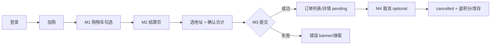
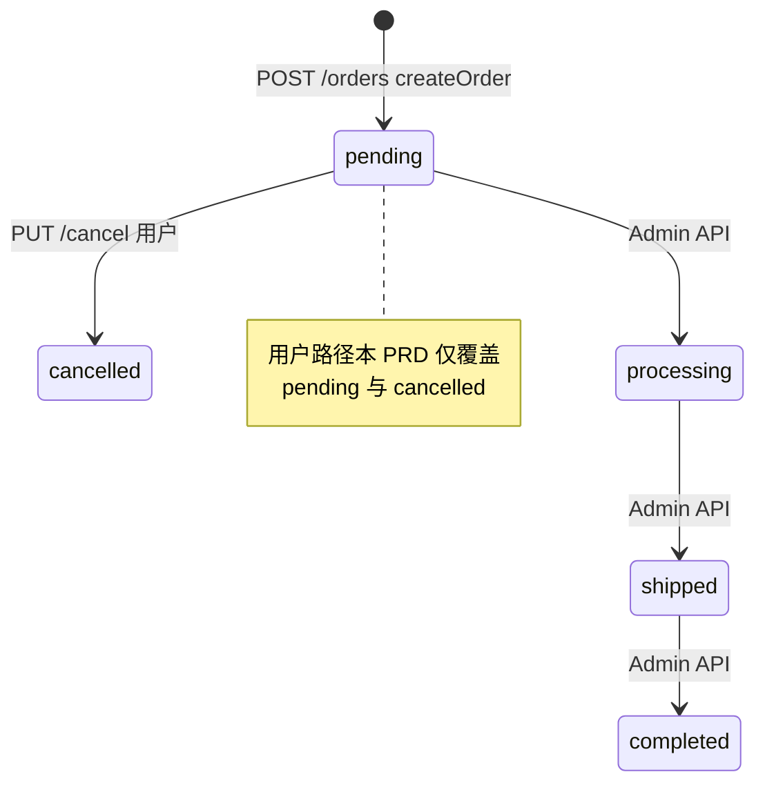

# 下单结算 · 产品需求说明书（PRD）

| 属性                     | 内容                                                                                           |
| ---------------------- | -------------------------------------------------------------------------------------------- |
| **文档 ID**              | PRD-order-checkout                                                                           |
| **文档版本**               | V1.0                                                                                         |
| **状态**                 | L2 待人闸（人闸-L2-PRD）                                                                            |
| **原型参考**               | `[product/order.html](order.html)`                                                           |
| **基线参考**               | `[product/baseline/project-baseline.md](baseline/project-baseline.md)`                       |
| **MVP 级别**             | 中等 — 购物车勾选 → 结算 → 下单 → 订单列表/详情/取消                                                            |
| **非目标**                | 真实支付、优惠券、拆单、完整售后、管理端结算                                                                       |
| **审查罗盘**               | `[product/compass-order-checkout.md](compass-order-checkout.md)`（prd-prototype-review QG 结果） |
| **生成**                 | L2-2 · `/opsx-explore` · 2026-08-04                                                          |

## 修订记录

| 版本   | 日期         | 修订人      | 说明                                                         |
| ---- | ---------- | -------- | ---------------------------------------------------------- |
| V1.0 | 2026-08-04 | AI Agent | 基于 `order.html` + L1 基线初稿；对齐 `prd-prototype-authoring` Kit |

---

## 1. 概述

### 1.1 背景

福利商城已有购物车、订单列表/详情与后端 `OrderService.createOrder`，但缺少结算页路由与 UI，且地址校验、购物车勾选未接通，无法演示完整兑换闭环。

### 1.2 目标

交付可演示的 **中等 MVP 下单结算闭环**：用户勾选购物车商品 → 进入结算页选地址 → 确认积分合计 → 提交订单 → 查看 `pending` 订单 → 可取消并退还积分/库存。

### 1.3 用户

已登录的普通用户（`role=user`），使用积分兑换福利商品。

### 1.4 系统范围

| 在范围内                     | 不在范围内             |
| ------------------------ | ----------------- |
| 购物车勾选、结算页、提交订单、错误态       | 真实支付网关            |
| 地址选择（列表单选）               | 优惠券 / 满减          |
| 订单列表/详情展示状态、用户取消 pending | 拆单、多仓             |
| 后端 addressId 必填 + 归属校验   | 管理端改状态（已知债，非用户路径） |

---

## 2. 模块索引

| ID     | 模块    | 职责                         | 前端                                  | 后端                             | 现状                 |
| ------ | ----- | -------------------------- | ----------------------------------- | ------------------------------ | ------------------ |
| **M1** | 购物车入口 | 勾选商品、展示合计、跳转结算             | `Cart.vue`                          | `CartService` + toggle API（待建） | ⚠️ toggle 未接通；路由缺失 |
| **M2** | 结算页   | 地址/商品/备注/合计/提交/错误态         | `Checkout.vue`（待建）、`/orders/create` | —                              | ❌ 缺失               |
| **M3** | 提交订单  | 校验、扣积分/库存、落库、清 cart        | 调 `POST /orders`                    | `OrderService.createOrder`     | ⚠️ 地址校验待加固         |
| **M4** | 订单取消  | pending → cancelled，退积分/库存 | `Orders.vue`                        | `OrderService.cancelOrder`     | ✅ 基本可用             |

### 2.1 用户旅程

---

## 3. 术语与状态机

### 3.1 术语

| 术语            | 定义                                       |
| ------------- | ---------------------------------------- |
| **积分**        | 用户兑换唯一货币；存于 `users.points`；下单一次性扣减       |
| **选中商品**      | `cart.is_selected = 1` 的条目；仅选中项参与结算      |
| **结算页**       | 路由 `/orders/create`                      |
| **订单快照**      | 下单时把收件人/电话/地址写入 `orders.receiver`*       |
| **服务端状态**     | `orders.status` 的合法值与转换 **仅由服务端** 定义与持久化 |
| **ORDER_001** | 下单业务失败错误码                                |
| **ORDER_002** | 订单不存在或无权操作                               |

### 3.2 订单状态枚举

| 值            | 含义      | 用户文案 |
| ------------ | ------- | ---- |
| `pending`    | 待处理（默认） | 待处理  |
| `processing` | 处理中     | 处理中  |
| `shipped`    | 已发货     | 已发货  |
| `completed`  | 已完成     | 已完成  |
| `cancelled`  | 已取消     | 已取消  |

### 3.3 状态流转（服务端为唯一计算方）

> **声明**：前端、HTML 原型、管理端 UI **不得**自行推断或本地改写 `orders.status`；展示与按钮启用条件 **必须** 以 API 返回值为准。

### 3.4 用户路径状态副作用

| 转换                      | 触发                        | 前置                    | 副作用                                       |
| ----------------------- | ------------------------- | --------------------- | ----------------------------------------- |
| → `pending`             | `POST /orders`            | 见 §7 AC               | 扣积分、减库存、PointsHistory(spend)、删除已下单 cart 项 |
| `pending` → `cancelled` | `PUT /orders/{id}/cancel` | 归属当前用户；status=pending | 退积分、回滚库存、PointsHistory(refund)            |

### 3.5 负向需求（MUST NOT）

| ID   | 约束                                    |
| ---- | ------------------------------------- |
| N-01 | MUST NOT 接入真实支付（银行卡/微信/支付宝等）          |
| N-02 | MUST NOT 实现优惠券、满减、促销码                 |
| N-03 | MUST NOT 拆单；一次提交 **一个** 订单            |
| N-04 | MUST NOT 在前端本地完成伪下单（扣积分/减库存仅能在服务端事务内） |
| N-05 | MUST NOT 由前端写入或猜测 `orders.status`     |
| N-06 | MUST NOT 允许用户取消非 `pending` 订单         |
| N-07 | MUST NOT 在生产结算页保留原型 `demo-bar` 演示控件   |
| N-08 | MUST NOT 无地址时静默下单                     |
| N-09 | MUST NOT 使用他人 `addressId` 下单          |
| N-10 | MUST NOT 将管理端物流/售后纳入本次用户路径            |

### 3.6 分层决策表

| 场景      | 地址校验                | 库存/积分校验          | 状态展示                  | 权威方               |
| ------- | ------------------- | ---------------- | --------------------- | ----------------- |
| 结算页加载   | 默认选中 `isDefault=1`  | 可 **预览** 合计与缺口提示 | 不涉及                   | 前端预览；**提交以服务端为准** |
| 点击提交    | **必须** 已选 addressId | **必须** 服务端校验     | 创建后读 API 返回 `pending` | **服务端**           |
| 订单列表/详情 | 展示快照字段              | —                | 只读 `order.status`     | **服务端**           |
| 取消订单    | —                   | 退积分/库存由服务端执行     | 取消后读 `cancelled`      | **服务端**           |

---

## 4. 功能需求

### 4.0 交互与样式约定（visual_level）

| 属性               | 值                                                                          |
| ---------------- | -------------------------------------------------------------------------- |
| **visual_level** | **L2**                                                                     |
| **对齐范围**         | Design Token（京东红 `#e4393c`、卡片阴影、步骤条）+ 关键区块布局；允许 site header / 导航 chrome 占位 |
| **原型基线**         | `product/order.html`                                                       |
| **不要求**          | L3/L4 像素级、双端 drill 矩阵                                                      |
| **响应式**          | 原型 `@media (max-width: 860px)` 单列布局宜保留                                     |

**原型区块索引**

| PRD-SECTION | 区块     | 元素                           |
| ----------- | ------ | ---------------------------- |
| 4.1.1       | 步骤条    | ①购物车 done → ②核对 active → ③成功 |
| 4.1.2       | 收货人信息  | 地址单选卡片列表、默认 tag              |
| 4.1.3       | 商品清单   | 图、名称、单价积分、数量、库存警告            |
| 4.1.4       | 订单备注   | textarea，maxlength=100       |
| 4.1.5       | 应付积分侧栏 | 件数、小计、合计、积分不足条、提交按钮          |
| 4.1.6       | 错误态    | 顶部 error-banner；提交失败 modal   |
| 4.1.7       | 成功态    | 跳转订单详情/列表（**非**原型本地弹窗终态）     |

### 4.0.1 接口与实现参考

| ID     | 能力  | 接口                                        | 用途              | 失败处理                |
| ------ | --- | ----------------------------------------- | --------------- | ------------------- |
| API-01 | 购物车 | `GET /api/cart`                           | 选中项与 summary    | 空 cart 引导回购物车       |
| API-02 | 勾选  | `PUT /api/cart/{id}/select`               | 持久化 is_selected | 待实现                 |
| API-03 | 地址  | `GET /api/addresses`                      | 结算页地址列表         | 空列表提示先添加地址          |
| API-04 | 下单  | `POST /api/orders` `{addressId, remark?}` | 创建订单            | ORDER_001 + message |
| API-05 | 取消  | `PUT /api/orders/{id}/cancel`             | 用户取消            | 非 pending 拒绝        |

### 4.1 M2 · 结算页字段矩阵

| 分组   | 字段             | 类型      | 必填  | 可编辑 | 说明                       |
| ---- | -------------- | ------- | --- | --- | ------------------------ |
| 地址   | addressId      | bigint  | 是   | 是   | 单选；默认 `isDefault=1`      |
| 地址展示 | receiver       | string  | —   | 否   | 来自 Address               |
| 地址展示 | phone          | string  | —   | 否   | 来自 Address               |
| 地址展示 | fullAddress    | string  | —   | 否   | 省市区 + detailAddress      |
| 商品   | productName    | string  | —   | 否   | 来自 cart + product        |
| 商品   | pointsRequired | int     | —   | 否   | 单价积分                     |
| 商品   | quantity       | int     | —   | 否   | 购买数量                     |
| 商品   | stockWarn      | boolean | —   | 否   | 库存 < quantity 时展示警告      |
| 订单   | remark         | string  | 否   | 是   | ≤100 字                   |
| 合计   | itemCount      | int     | —   | 否   | 选中件数                     |
| 合计   | totalPoints    | int     | —   | 否   | 应付积分                     |
| 合计   | userPoints     | int     | —   | 否   | 当前可用积分                   |
| 合计   | pointsGap      | int     | —   | 否   | max(0, total - user)；预览用 |
| 操作   | submit         | button  | —   | —   | 触发 POST /orders          |

### 4.2 M1 · 购物车

- 勾选变更须持久化 `is_selected`（toggle API）。
- 「结算」跳转 `/orders/create`；无选中项时拦截或结算页提示。

### 4.3 M3 · 提交订单（后端加固）

相对现实现 **必须** 补齐：

1. `addressId` 非空校验
2. 地址 `userId` 归属校验
3. （P1）商品 `status=active` 校验

错误 message 参考 baseline §8.3 与 §7 AC。

### 4.4 M4 · 订单取消

- 列表页已有取消；详情页取消按钮 P2。
- 仅 `pending` 可取消；状态以服务端为准。

---

## 5. 数据需求（摘要）

| 实体             | 关键字段                                        | 说明                         |
| -------------- | ------------------------------------------- | -------------------------- |
| orders         | status, total_points, address_id, receiver* | status 服务端写入               |
| order_items    | subtotal_points                             | points_required × quantity |
| cart           | is_selected                                 | 0/1                        |
| points_history | type=spend/refund                           | 关联 order id                |

---

## 6. 权限

- 所有结算 API 须 JWT 认证；订单/地址操作校验 `userId` 归属。
- 管理端订单状态变更不在本 PRD 用户路径内。

---

## 7. 验收规则

> **Coverage 最小集**：`Cov-ID` 对齐 `project-baseline.md` §13 测试矩阵 **T1–T10**（`prep/coverage-scope.md` 待 L3 正式化）。

### 7.1 M3 · 提交订单

| AC-ID | 场景     | 给定                   | 当    | 则                                                   | PRD       | Cov-ID | 测试       |
| ----- | ------ | -------------------- | ---- | --------------------------------------------------- | --------- | ------ | -------- |
| AC-01 | 正常下单闭环 | 有选中项；积分≥合计；库存足；有默认地址 | 提交订单 | 200；status=**pending**（服务端）；积分减；库存减；cart 清除；可进列表/详情 | §3.4      | T1     | 集成 + E2E |
| AC-02 | 无选中商品  | cart 全未选             | 提交   | ORDER_001；无新订单                                      | §4.3      | T2     | 集成       |
| AC-03 | 库存不足   | stock < quantity     | 提交   | ORDER_001；含商品名；无新订单                                 | §4.1      | T3     | 集成       |
| AC-04 | 积分不足   | user.points < total  | 提交   | ORDER_001；含当前/需要积分；无新订单                             | §4.1.5    | T4     | 集成       |
| AC-05 | 未选地址   | addressId 缺失         | 提交   | ORDER_001；前端提示选地址；无新订单                              | §3.5 N-08 | T5     | 集成 + E2E |
| AC-06 | 地址不归属  | 他人 addressId         | 提交   | ORDER_001；拒绝                                        | §3.5 N-09 | T6     | 集成       |
| AC-09 | 并发抢库存  | 最后 1 件库存             | 并发提交 | 不出现负库存； ideally 仅一单成功                               | §4.3      | T9     | 集成 P2    |

### 7.2 M4 · 订单取消与状态

| AC-ID | 场景          | 给定             | 当      | 则                      | PRD       | Cov-ID | 测试  |
| ----- | ----------- | -------------- | ------ | ---------------------- | --------- | ------ | --- |
| AC-07 | 取消 pending  | status=pending | 取消     | cancelled；退积分；回滚库存     | §3.4      | T7     | 集成  |
| AC-08 | 取消非 pending | status≠pending | 取消     | 拒绝；状态不变                | §3.5 N-06 | T8     | 集成  |
| AC-14 | 状态只读展示      | 下单成功           | 查列表/详情 | 展示 API 返回 status，非前端写死 | §3.3      | T1     | E2E |

### 7.3 M1/M2 · 前端闭环

| AC-ID | 场景      | 给定            | 当          | 则                          | PRD  | Cov-ID | 测试       |
| ----- | ------- | ------------- | ---------- | -------------------------- | ---- | ------ | -------- |
| AC-10 | 结算 E2E  | 页面已实现         | 选地址→提交→看结果 | 主路径通；≥1 异常有可见错误            | §4.0 | T10    | E2E      |
| AC-11 | L2 区块齐全 | 打开结算页         | 目视         | 地址/商品/备注/合计/提交/错误态         | §4.0 | —      | 人工       |
| AC-12 | 默认地址    | 有 isDefault=1 | 进入结算页      | 默认选中                       | §4.1 | —      | E2E      |
| AC-15 | 购物车勾选   | 购物车页          | 勾选/取消      | is_selected 持久化；summary 更新 | §4.2 | —      | 集成 + E2E |

### 7.11 验收追溯总表

| AC-ID    | 验收需求摘要             | 场景数 | OpenSpec capability（待建） | 自动化测试     | 人工    |
| -------- | ------------------ | --- | ----------------------- | --------- | ----- |
| AC-01    | 正常下单 pending + 副作用 | 1   | `order-checkout/create` | T1 集成/E2E | 走查    |
| AC-02    | 无选中拒绝              | 1   | 同上                      | T2        | —     |
| AC-03    | 库存不足               | 1   | 同上                      | T3        | —     |
| AC-04    | 积分不足               | 1   | 同上                      | T4        | —     |
| AC-05    | 未选地址               | 1   | 同上                      | T5        | 走查    |
| AC-06    | 地址越权               | 1   | 同上                      | T6        | —     |
| AC-07    | 取消退积分库存            | 1   | `order-checkout/cancel` | T7        | 走查    |
| AC-08    | 非 pending 不可取消     | 1   | 同上                      | T8        | —     |
| AC-09    | 并发库存               | 1   | 同上                      | T9 P2     | —     |
| AC-10    | 前端 E2E             | 1   | `order-checkout/ui`     | T10 E2E   | 走查    |
| AC-11~15 | UI/勾选              | 5   | `order-checkout/ui`     | 部分 E2E    | L2 人闸 |

---

## 8. 开放问题

| #    | 问题                        | 状态                           |
| ---- | ------------------------- | ---------------------------- |
| O-01 | 新增地址 UI：结算页内嵌 vs Profile？ | ⚠️ 默认仅选择；新增放 Profile 或 P2    |
| O-02 | 下单成功跳转列表还是详情？             | ⚠️ 默认 `/orders/{id}`         |
| O-03 | JDK 17 vs 21              | ✅ 以 pom 17 为准                |
| O-04 | coverage 包范围              | ⚠️ L3 对齐 `coverage-scope.md` |

---

## 9. 参考文档

- `[product/order.html](order.html)` — L2 原型
- `[product/baseline/project-baseline.md](baseline/project-baseline.md)` — L1 基线
- `[product/compass-order-checkout.md](compass-order-checkout.md)` — prd-prototype-review / 罗盘
- `.cursor/skills/prd-prototype-authoring/SKILL.md`
- `.cursor/skills/prd-prototype-review/SKILL.md`

---

## 人闸-L2-PRD 检查清单

- [x] §3.3 服务端为状态唯一计算方
- [x] §3.5 负向需求无支付/优惠券/拆单
- [x] §7 覆盖闭环 + 状态 + 库存/积分/地址异常
- [x] Cov-ID 映射 T1–T10
- [x] §4.0 visual_level L2 与原型区块一致
- [x] compass 已记录 PRD↔原型差距