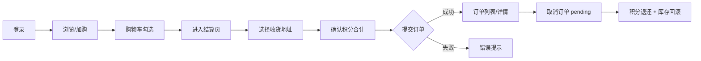
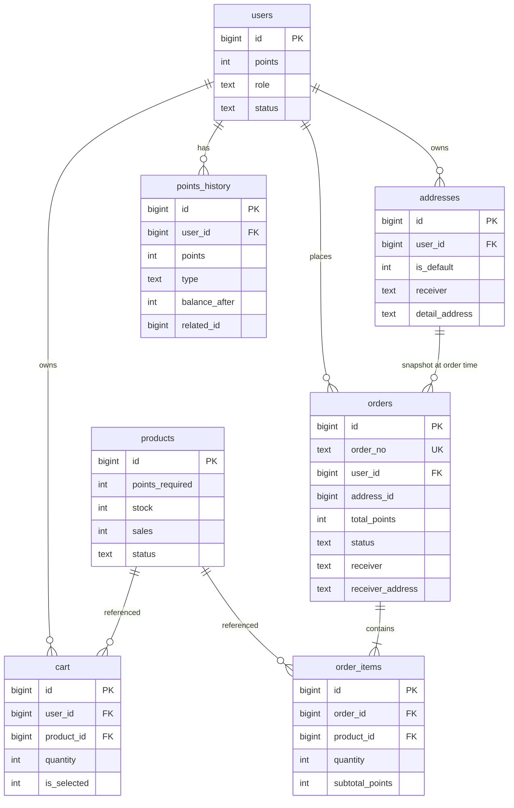
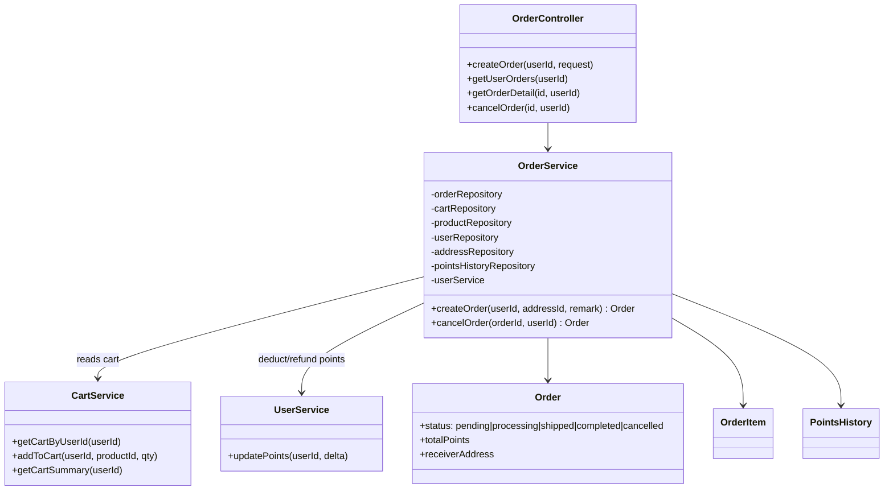
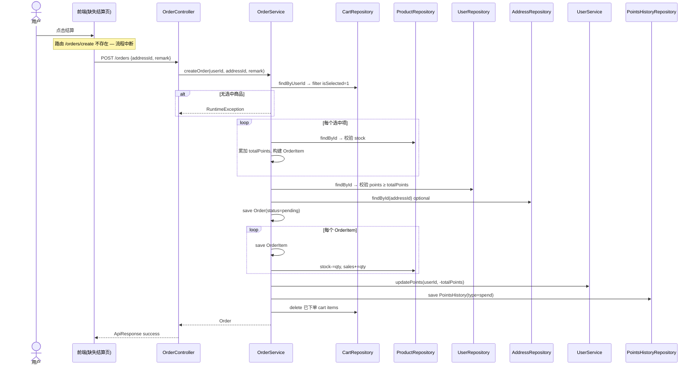
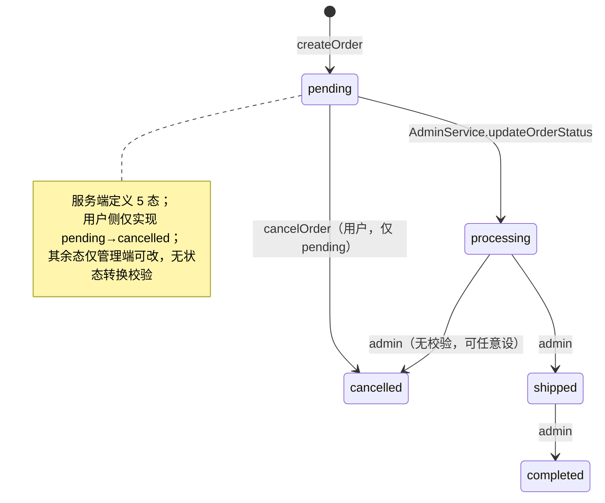

# 福利商城 · 下单结算 — 项目基线（L1）

> **仓库**：`E:\01工作坊s\aecos_workshop`（远程 [market_workshop](https://github.com/simonhehe/market_workshop.git)，分支 `aecos_workshop`）  
> **GitNexus MCP 名**：`market_workshop`（查询时须用绝对路径 `E:\01工作坊s\aecos_workshop` 消歧）  
> **索引**：722 nodes · 1,314 edges · 39 clusters · 58 processes · commit `b569699` · ✅ up-to-date  
> **预览**：GitNexus serve → `http://localhost:4747`  
> **工作坊目标**：中等 MVP — 购物车 → 选地址 → 下单 → 扣积分/库存 → 订单列表/详情/取消  
> **非目标**：真实支付、优惠券、拆单、完整售后

---

## 1. 技术栈


| 层     | 技术                                   | 版本/说明                                   |
| ----- | ------------------------------------ | --------------------------------------- |
| 后端运行时 | Java                                 | 17（pom 声明；课件提及 JDK 21，以 pom 为准）         |
| 后端框架  | Spring Boot                          | 3.2.0                                   |
| ORM   | Spring Data JPA + Hibernate          | SQLite 方言                               |
| 数据库   | SQLite                               | `./database/mall.db`，`ddl-auto: update` |
| 认证    | JWT（自研 `JwtUtil` + `AuthMiddleware`） | Bearer Token，24h 过期                     |
| 前端    | Vue 3 + Vue Router 4                 | Options API                             |
| 构建    | Maven（后端）/ Vite 5（前端）                | 前端 dev 默认 Vite proxy → `/api`           |
| 测试    | —                                    | **零测试文件**                               |
| 迁移    | Flyway 占位                            | `V1__init.sql` 为空，Schema 由 JPA 自动建表     |


**GitNexus 结算相关执行流（Top）**


| Process                  | 摘要                                                                                         |
| ------------------------ | ------------------------------------------------------------------------------------------ |
| `proc_14_createorder`    | `OrderController.createOrder` → `OrderService.createOrder` → `CartRepository.findByUserId` |
| `proc_1_createorder`     | `createOrder` → `UserService.updatePoints`                                                 |
| `proc_15/16_createorder` | `createOrder` → `OrderItem` / `Order` 实体落库                                                 |
| `proc_25_addtocart`      | `CartController.addToCart` → `CartService.addToCart` → 查重/合并                               |


---


## 2. 模块概览（结算相关）

```
backend/com/example/mall/
├── controller/   OrderController, CartController, AddressController, PointsHistoryController
├── service/      OrderService ★, CartService, AddressService, UserService, PointsHistoryService
├── entity/       Order, OrderItem, Cart, Product, User, Address, PointsHistory
├── repository/   对应 JPA Repository
├── middleware/   AuthMiddleware（JWT 拦截）
└── config/       DataInitializer（种子数据）

frontend/src/
├── views/        Cart.vue ★, Orders.vue, OrderDetail.vue — **缺 Checkout/结算页**
├── api/          cart.js, order.js, address.js
└── router/       **无 `/orders/create` 路由**
```

---


## 3. 结算主流程（现状 vs 目标）


### 3.1 目标用户旅程




### 3.2 现状断点


| 步骤      | 后端                                          | 前端                              | 状态              |
| ------- | ------------------------------------------- | ------------------------------- | --------------- |
| 加购      | ✅ `POST /cart`                              | ✅ ProductDetail                 | 可用              |
| 购物车勾选   | ⚠️ 有 `is_selected` 字段，**无 toggle API**      | ❌ `toggleSelect` 空实现            | **缺口**          |
| 进入结算    | —                                           | ❌ 跳转 `/orders/create` **路由不存在** | **阻塞**          |
| 选地址     | ✅ `GET/POST /addresses`                     | ❌ 无地址管理/结算选地址 UI                | **缺口**          |
| 提交订单    | ✅ `POST /orders`                            | ❌ 无结算页调用 `orderApi.createOrder` | **缺口**          |
| 扣积分/库存  | ✅ `OrderService.createOrder` @Transactional | —                               | 基本实现            |
| 订单列表/详情 | ✅ `GET /orders`, `GET /orders/{id}`         | ✅ Orders.vue, OrderDetail.vue   | 可用              |
| 取消订单    | ✅ `PUT /orders/{id}/cancel`                 | ✅ Orders.vue                    | 仅 `pending` 可取消 |


---


## 4. ER 图（结算域）




---


## 5. 类图（结算核心）




---


## 6. 时序图 — 下单（当前实现）




---


## 7. 订单状态机




| 状态           | 含义      | 谁可触发               | 副作用                      |
| ------------ | ------- | ------------------ | ------------------------ |
| `pending`    | 待处理（默认） | 下单                 | 已扣积分/库存                  |
| `processing` | 处理中     | Admin API          | 无                        |
| `shipped`    | 已发货     | Admin API          | 无                        |
| `completed`  | 已完成     | Admin API          | 无                        |
| `cancelled`  | 已取消     | 用户（pending）/ Admin | 退还积分+回滚库存（仅用户 cancel 路径） |


**缺口**：无服务端状态转换规则；Admin 改状态不触发库存/积分副作用；用户取消后不可恢复。

---


## 8. API 契约（结算域）

Base URL: `http://localhost:8080/api` · Auth: `Authorization: Bearer <token>`

### 8.1 购物车


| Method | Path              | Body                     | 响应                                                                           | 备注               |
| ------ | ----------------- | ------------------------ | ---------------------------------------------------------------------------- | ---------------- |
| GET    | `/cart`           | —                        | `{cartItems[], summary{totalCount,selectedCount,totalPoints,totalQuantity}}` | ✅                |
| POST   | `/cart`           | `{productId, quantity?}` | Cart                                                                         | 合并同 SKU ✅        |
| PUT    | `/cart/{id}`      | `{quantity}`             | Cart/null                                                                    | ⚠️ 无 userId 归属校验 |
| DELETE | `/cart/{id}`      | —                        | void                                                                         | ⚠️ 无归属校验         |
| —      | **toggle select** | —                        | —                                                                            | ❌ **缺失**         |


### 8.2 地址


| Method | Path              | Body         | 响应        | 备注               |
| ------ | ----------------- | ------------ | --------- | ---------------- |
| GET    | `/addresses`      | —            | Address[] | 按 isDefault 降序 ✅ |
| POST   | `/addresses`      | Address JSON | Address   | ✅                |
| PUT    | `/addresses/{id}` | Address JSON | Address   | 归属校验 ✅           |
| DELETE | `/addresses/{id}` | —            | void      | 软删 ✅             |


### 8.3 订单


| Method | Path                  | Body                    | 响应                    | 错误码       | 备注                      |
| ------ | --------------------- | ----------------------- | --------------------- | --------- | ----------------------- |
| POST   | `/orders`             | `{addressId?, remark?}` | Order                 | ORDER_001 | ⚠️ addressId 可空；无地址归属校验 |
| GET    | `/orders`             | —                       | Order[]               | ORDER_002 | ✅                       |
| GET    | `/orders/{id}`        | —                       | `{order, orderItems}` | ORDER_002 | 归属校验 ✅                  |
| PUT    | `/orders/{id}/cancel` | —                       | Order                 | ORDER_002 | 仅 pending ✅             |


**createOrder 业务错误（RuntimeException → ORDER_001）**

- 购物车无选中商品
- 商品不存在 / 库存不足
- 积分不足（含当前/需要积分）
- 收货地址不存在

**缺失的错误场景（应补）**

- 未选地址（addressId null/缺失）→ 当前**允许**无地址下单
- 地址不属于当前用户
- 商品已下架（status != active）
- 并发超卖

---


## 9. 并发与一致性


| 风险              | 现状                                                        | 建议（工作坊范围）                              |
| --------------- | --------------------------------------------------------- | -------------------------------------- |
| 库存超卖            | `findById` + 内存比较 + save，无行锁/乐观锁                          | 下单前 `SELECT … FOR UPDATE` 或 `@Version` |
| 积分双花            | `updatePoints` 读-改-写，无锁                                   | 同一事务内悲观锁 user 行或 CAS                   |
| 重复提交            | 无幂等键                                                      | 前端防抖 + 可选 clientToken                  |
| 事务边界            | `createOrder`/`cancelOrder` 有 `@Transactional`            | ✅ 基本正确                                 |
| balanceAfter 不准 | `PointsHistory.balanceAfter` 用扣减**前**的 `user.getPoints()` | **Bug**：应先 flush 再读或计算                 |


---


## 10. 安全


| 项          | 现状                                        | 缺口                   |
| ---------- | ----------------------------------------- | -------------------- |
| 认证         | JWT 过滤器，除 `/auth/login`、`/products` 等公开路径 | ✅ 基本可用               |
| 授权         | 订单/地址操作校验 userId 归属                       | ⚠️ 下单时 address 未校验归属 |
| 购物车操作      | PUT/DELETE cart 未校验 cart.userId           | **越权风险**             |
| 密码         | DataInitializer 测试用户明文密码                  | 演示可接受                |
| JWT Secret | 硬编码于 `application.yml`                    | 演示可接受                |


---


## 11. 前端缺口清单


| #   | 缺口                 | 严重度 | 说明                                        |
| --- | ------------------ | --- | ----------------------------------------- |
| F1  | **结算页缺失**          | P0  | `Cart.vue` → `/orders/create`，router 无此路由 |
| F2  | **地址选择与展示**        | P0  | `addressApi` 已有，无 UI（Profile 也无地址管理）      |
| F3  | **提交订单**           | P0  | 无页面调用 `orderApi.createOrder`              |
| F4  | **购物车勾选**          | P1  | checkbox 无后端 toggle；默认全选依赖 DB             |
| F5  | **错误态展示**          | P1  | 库存/积分/地址错误需在结算页友好提示                       |
| F6  | **积分合计预览**         | P1  | 购物车有 summary，结算页应复现/确认                    |
| F7  | **下单成功跳转**         | P2  | 成功后应进订单详情或列表                              |
| F8  | **OrderDetail 取消** | P2  | 详情页无取消按钮（列表有）                             |


---


## 12. 数据字典（结算域）


| 表/实体               | 字段              | 类型      | 说明                                             |
| ------------------ | --------------- | ------- | ---------------------------------------------- |
| **orders**         | order_no        | TEXT UK | `ORD` + timestamp 自动生成                         |
|                    | status          | TEXT    | pending/processing/shipped/completed/cancelled |
|                    | total_points    | INT     | 订单总积分                                          |
|                    | address_id      | BIGINT  | 可空；快照 receiver* 字段                             |
| **order_items**    | subtotal_points | INT     | points_required × quantity                     |
| **cart**           | is_selected     | INT 0/1 | 下单 filter 条件                                   |
| **products**       | points_required | INT     | 兑换单价（积分）                                       |
|                    | stock           | INT     | 可售库存                                           |
| **points_history** | type            | TEXT    | earn/spend/adjust/refund                       |
|                    | balance_after   | INT     | 操作后余额（当前实现可能不准）                                |
| **addresses**      | is_default      | INT 0/1 | 默认地址标记                                         |


**种子用户（DataInitializer）**


| 用户名   | 密码        | 积分  | 角色    |
| ----- | --------- | --- | ----- |
| user1 | password1 | 100 | user  |
| user2 | password2 | 200 | user  |
| user3 | password3 | 150 | user  |
| admin | （加密）      | —   | admin |


---


## 13. 测试矩阵（当前 = 全空）


| ID  | 场景                | 预期                                 | 现状               |
| --- | ----------------- | ---------------------------------- | ---------------- |
| T1  | 正常下单（有地址、有积分、有库存） | 201/200，订单 pending，积分扣减，库存减少，购物车清空 | 后端逻辑有，**无自动化测试** |
| T2  | 购物车无选中            | ORDER_001 错误                       | 后端有，未测           |
| T3  | 库存不足              | ORDER_001 含商品名                     | 后端有，未测           |
| T4  | 积分不足              | ORDER_001 含当前/需要积分                 | 后端有，未测           |
| T5  | 未选地址              | 应拒绝                                | **当前允许** — 缺口    |
| T6  | 地址不属于用户           | 应拒绝                                | **未校验** — 缺口     |
| T7  | 取消 pending 订单     | cancelled，积分退还，库存回滚                | 后端有，未测           |
| T8  | 取消非 pending       | 拒绝                                 | 后端有，未测           |
| T9  | 并发双下单抢库存          | 仅一单成功                              | **未防护**          |
| T10 | 前端结算页 E2E         | 选地址→提交→看结果                         | **页面不存在**        |


---


## 14. 缺口汇总（工作坊交付输入）


### P0 — 阻塞演示闭环

1. **前端结算页**（路由 + 页面 + 调 `POST /orders`）
2. **地址选择 UI**（至少列出用户地址并选择默认）
3. **后端：addressId 必填 + 归属校验**
4. **购物车勾选 API**（或前端直连现有字段的后端 endpoint）


### P1 — 质量与体验

1. 结算页错误态（库存/积分/地址）
2. `PointsHistory.balanceAfter` 计算修正
3. 购物车 PUT/DELETE 归属校验
4. 商品 status=active 校验


### P2 — 可选加固

1. 库存/积分并发锁
2. 下单幂等
3. OrderDetail 取消按钮
4. 自动化测试（T1–T10）


### 明确不做

- 支付网关、优惠券、拆单、完整物流/售后

---

*生成：L1 GitNexus 存量扫描 · commit* `b569699` *· 2026-08-04*