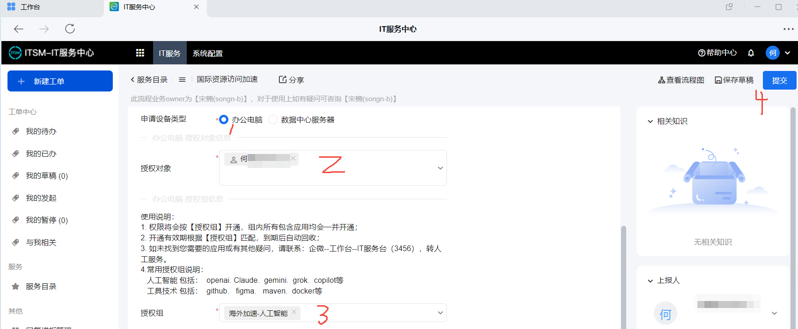
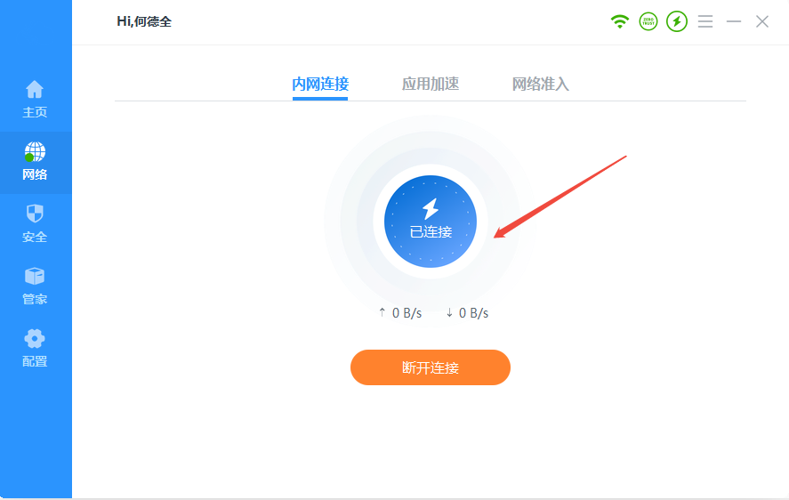
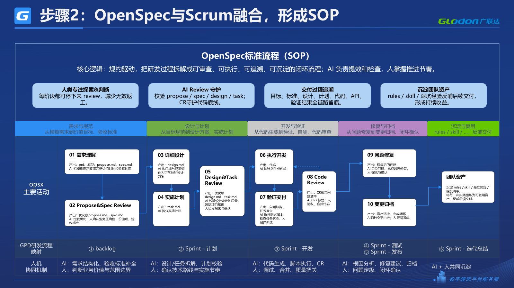

# 《AI Coding Workshop》环境准备 for 福利商城 · 下单结算

> **项目**：`ywpt_workshop_test`（GitNexus MCP 名多为 `market_workshop`）  
> **模板来源**：`workshop/example/《AI Coding Workshop》环境准备 for PMSmart.docx`  
> **约定**：下列步骤一律在 **Cursor Agent 对话框** 中触发；不要求学员在系统终端手工敲命令。

适用场景：SpecCoding；工具+SDD框架带来的AI协同交付体验  
安装内容：第二部分内容必须安装，其他为拓展选装部分

---

## 一、推荐安装顺序

先准备网络环境，确保可访问下载源  
申请 Cursor 账号  
先安装 Cursor，再安装 Node.js  
因为后续 OpenSpec 通过 npm 安装，依赖 Node.js  
然后安装 OpenSpec、superpowers、GitNexus，并完成版本验证  
（对本仓 **建索引 / analyze** 放到工作坊正文 P0，不在本页完成）

---

## 二、环境准备步骤（必须）

### 第 1 步：网络环境准备

开通网络加速：【IT服务中心】-【网络服务】-【国际资源访问加速】

操作示意（原 Word 插图）：



> 图片文件：[`ywpt-prep-image1.png`](./ywpt-prep-image1.png)

连接公司要求的网络环境（如 Glink），打开内网连接

操作示意（原 Word 插图）：



> 图片文件：[`ywpt-prep-image2.png`](./ywpt-prep-image2.png)

确认以下站点可正常访问：

- [https://github.com](https://github.com)  
- [Node.js — Run JavaScript Everywhere](https://nodejs.org/)  
- [npm | Home](https://www.npmjs.com/)  

如工作坊包含测试环节，建议同时确认以下站点可访问：

- [Welcome to Apache Maven – Maven](https://maven.apache.org/)  
- [Fast and reliable end-to-end testing for modern web apps | Playwright](https://playwright.dev/)  

---

### 第 2 步：Cursor 订阅 & 安装

#### 2.1 Cursor 订阅

（按公司采购 / 培训统一账号流程完成订阅与激活。）

#### 2.2 Cursor 安装

下载地址：https://cursor.com/download  

安装对应操作系统版本。  
打开 Cursor，使用 2.1 中激活的账号完成登录。  

建议首次启动后完成基础检查：

- 能正常打开本地目录  
- 能打开内置终端（仅作观察；本手册步骤不依赖手工敲命令）  
- 能使用对话功能  

---

### 第 3 步：安装 Node.js

下载地址：https://nodejs.org/en/download  

安装 LTS 版本，且 Node.js 版本 ≥ 20。  

安装完成后，在 **Agent 对话框** 输入：

```text
检查本机 Node.js 与 npm 是否已安装且可用：输出 node -v、npm -v；要求 Node 版本 ≥ 20。若未安装或版本过低，给出安装/升级指引（我确认后再执行）。
```

通过标准：对话回复中可见 `node` / `npm` 版本号，且 Node ≥ 20。

---

### 第 4 步：安装 OpenSpec

在 **Agent 对话框** 输入（推荐，与原 Word「从 github 安装」一致）：

```text
从 github 安装 openspec（全局安装 @fission-ai/openspec@latest），安装完成后验证 openspec --version，把版本号回复给我。
```

备选说法（等价）：

```text
安装 OpenSpec 到本机，并确认 openspec 命令可用；回复版本号。
```

- [ ] 对话中能看到 OpenSpec 版本号  

---

### 第 5 步：安装 superpowers

在 **Agent 对话框** 输入：

```text
安装 superpowers
```

确认就绪：手动输入 `/br`，Cursor 自动带出 `/brainstorming`。

- [ ] 能带出 `/brainstorming`  

---

### 第 6 步：安装 GitNexus（本工作坊新增）

在 **Agent 对话框** 输入：

```text
安装 GitNexus（优先 npm i -g gitnexus；若 npx 在 npm 11 崩溃则改用全局安装），安装完成后验证 gitnexus --version（或等价），把版本号回复给我。不要对本仓库做 analyze / 建索引。
```

- [ ] 对话中能看到 GitNexus 版本号（安装成功）  

> **建索引（analyze）不在本步**：放到工作坊正文 **P0 存量扫描**（见 [`aecos_workshop.md`](./aecos_workshop.md)）。

---

### 第 7 步：从 GitHub 仓库分支下载本工作坊项目

| 项 | 值 |
|----|-----|
| 仓库 | https://github.com/simonhehe/market_workshop.git |
| 分支 | `workshop_ywpt_test` |
| 说明 | 福利商城 · 下单结算工作坊载体 |

在 **Agent 对话框** 输入：

```text
从 GitHub 克隆本工作坊代码并切换到指定分支后，用 Cursor 打开项目根目录：
- 仓库：https://github.com/simonhehe/market_workshop.git
- 分支：workshop_ywpt_test
克隆完成后确认根目录含 backend、frontend、workshop，并把当前分支名回复给我。
```

备选（已有该仓、只需切分支）：

```text
确认当前工作区对应 https://github.com/simonhehe/market_workshop.git ，检出并跟踪分支 workshop_ywpt_test；确认根目录含 backend、frontend、workshop，回复当前分支名。
```

- [ ] 已从上述仓库下载 / 更新代码  
- [ ] 当前分支为 `workshop_ywpt_test`  
- [ ] 可见 `backend/`、`frontend/`、`workshop/`  

课前环境细节（端口、SQLite 目录、kit 校验等）见：`workshop/prep/env-setup.md`（可选深化；本页为 Word 模板对齐的学员必装清单）。

---

## 三、环境检查清单（培训前逐项确认）

| 检查项 | 检查方式（Chat） | 通过标准 | 是否必选 | 状态 |
|--------|------------------|----------|----------|------|
| 网络环境 | 浏览器访问 GitHub / nodejs.org / npm | 可正常打开 | 是 | |
| Cursor | 启动并登录 | 可打开项目目录与对话 | 是 | |
| Node.js | Chat：检查 node / npm 版本 | Node ≥ 20 | 是 | |
| npm | 同上 | 可正常返回版本号 | 是 | |
| OpenSpec | Chat：安装并验证版本 | 对话中返回版本号 | 是 | |
| superpowers | Chat：安装 superpowers；`/br` | 能带出 brainstorming | 是 | |
| GitNexus | Chat：安装并验证版本 | 对话中返回版本号 | 是 | |
| 项目代码 | Chat：从 GitHub 拉取分支 `workshop_ywpt_test` | 分支正确且含 backend/frontend/workshop | 是 | |

---

## 附录

### 1、Cursor

基础功能介绍

| 对话模式用途 | 阶段 | 传统 | AI |
|--------------|------|------|-----|
| 理解 | 理解 + 拆解：目标、理解、规划 | | Plan |
| 实现 | 写代码、写用例、… | | Agent |
| 调试 | 定位问题，解决问题 | | Debug |

### 2、主流 SDD 工具（GPT生成，仅供参考）

| 维度 | Spec Kit（GitHub） | OpenSpec | BMAD Method | PromptX |
|------|--------------------|----------|-------------|---------|
| 出品组织 | GitHub | Fission AI | 社区方法论（独立AI工程社区） | 社区项目（Prompt工程社区） |
| 所在国家/地区 | 美国 | 美国（开源社区主导） | 无明确国家（偏欧美） | 无明确国家（偏欧美） |
| 组织类型 | 科技公司（微软体系） | 开源组织 | 方法论 / 社区 | 开源社区 |
| 开源情况 | 开源 | 开源 | 半开源（无标准实现） | 部分开源 |
| 定位 | 标准化 Spec-Driven 工具包 | 轻量 Spec 工作流 | 多 Agent 开发方法论 | Prompt + Spec 框架 |
| 核心理念 | Spec = 可执行文档 | Spec = 变更驱动 | Spec = 多角色协作输入 | Spec = Prompt模板源 |
| 复杂度 | ⭐⭐⭐ | ⭐⭐ | ⭐⭐⭐⭐ | ⭐⭐⭐ |
| 学习成本 | 中 | 低 | 高 | 中 |
| Spec结构化程度 | 高（模板+阶段） | 中（简化 spec） | 高（多角色+流程） | 中（偏 prompt结构） |
| Agent支持 | 外部Agent（Copilot/Claude等） | IDE Agent（Cursor等） | 内置多Agent体系 | 强（Prompt驱动Agent） |
| 多Agent能力 | ❌ | ❌ | ✅（核心能力） | ⚠️（弱） |
| 上下文管理 | 强（memory files） | 中（轻量上下文） | 强（角色隔离上下文） | 中（prompt上下文） |
| 工程化能力 | ⭐⭐⭐⭐ | ⭐⭐ | ⭐⭐⭐⭐ | ⭐⭐⭐ |
| 规范约束能力 | 强（Spec校验+流程） | 中 | 强（流程+角色） | 中 |
| 扩展性 | 高（CLI + GitHub生态） | 中 | 高（Agent可扩展） | 中 |
| Token成本 | 中 | 低 | 高 | 中 |
| 适合团队规模 | 中大型团队 | 中小团队 | 大型复杂项目 | AI实验/Agent团队 |
| 典型优势 | 标准化 + 可落地 | 简洁高效 | 复杂系统控制力强 | Prompt工程强 |
| 典型短板 | 稍重 | 能力有限 | 过重 | 工程化不足 |

### 3、OpenSpec 指令总览

OpenSpec 指令总览（培训现场按课件展开）。

### 4、AICoding 工作坊

- 总课件：[`aecos_workshop.md`](./aecos_workshop.md)  
- 参考示例：`workshop/example/《AI Coding Workshop》课件 for PMSmart.md`  

### 5、AI 开发提效实施方案（OpenSpec × Cursor）hedq

建议阅读第三章，了解 OpenSpec 核心指令用途。

附图（原 Word 插图）：



> 图片文件：[`ywpt-prep-image3.png`](./ywpt-prep-image3.png)
