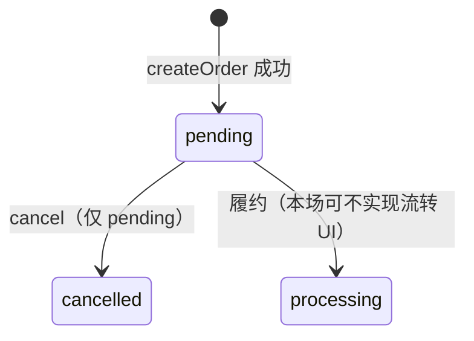

# PRD · 下单结算

| 字段 | 值 |
|------|-----|
| 版本 | 0.2-unattended |
| 状态 | Confirmed · agent-proxy PO |
| 原型 | `workshop/product/order.html` |
| OpenSpec | `order-checkout-hardening` |
| visual_level | L2 |

## 1. 模块索引

| ID | 模块 | 说明 |
|----|------|------|
| M1 | 结算页 `/orders/create` | 地址必选、商品摘要、积分合计、提交、错误态 |
| M2 | 订单列表/详情 | 展示 pending/cancelled 等；支持取消 pending |

## 2. 术语与状态机

### 2.1 术语

| 术语 | 定义 |
|------|------|
| 选中购物车项 | `Cart.isSelected=1` |
| 应付积分 | Σ(单价积分 × 数量) |
| 下单成功 | 生成订单 status=`pending`，扣库存与积分，清除已下单项 |

### 2.2 订单状态机

服务端为状态唯一计算方。本场无真实支付；`pending` = 已下单待履约。

## 3. 负向需求（MUST NOT）

- MUST NOT 引入真实三方支付或优惠券。
- MUST NOT 在未选地址时创建订单。
- MUST NOT 静默扣减未选中购物车项。
- MUST NOT 取消非 pending 订单。

## 4. 字段 / 交互要点

| 场景 | 地址 | 提交 | 失败展示 |
|------|------|------|----------|
| 正常 | 必选有效 addressId | POST `/api/orders` | — |
| 无地址 | 空 | 禁止 / 服务端拒绝 | 「请先选择收货地址」类文案 |
| 库存不足 | 任意 | 拒绝 | 含商品名 |
| 积分不足 | 任意 | 拒绝 | 含当前/需要积分 |

## 5. 验收规则表

| AC-ID | 场景 | 给定 | 当 | 则 | 追溯 | 测试 |
|-------|------|------|----|----|------|------|
| AC-CREATE | 正常下单 | 选中项、库存足、积分足、地址有效 | 提交 | 订单 pending，扣库存积分，清购物车选中项 | M1 | UT/API/E2E |
| AC-STOCK | 库存不足 | 库存 &lt; 数量 | 提交 | 失败，不扣积分 | M1 | UT |
| AC-POINTS | 积分不足 | 余额 &lt; 应付 | 提交 | 失败，不扣库存 | M1 | UT |
| AC-ADDR | 地址缺失 | addressId 空或非法 | 提交 | 失败 | M1 | UT |
| AC-AUTH | 未登录 | 无 token | POST /orders | 鉴权失败 | M1 | API |
| AC-CANCEL | 取消 | pending 订单属本人 | 取消 | status=cancelled，退积分 | M2 | UT |
| AC-ROUTE | 结算入口 | 购物车有选中 | 点结算 | 进入 `/orders/create` 而非 404 | M1 | E2E/手工 |

## 6. 修订记录

| 日期 | 变更 | 作者 |
|------|------|------|
| 2026-08-04 | 骨架 | workshop-kit |
| 2026-08-04 | 无人值守补全中等 MVP AC | agent-proxy |
