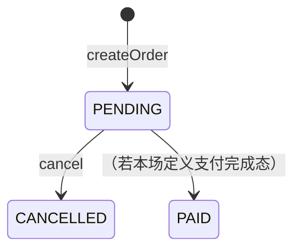

# PRD · 下单结算

| 字段 | 值 |
|------|-----|
| 版本 | 0.1-skeleton |
| 状态 | Draft · P1 现场补全 |
| 原型 | `workshop/product/order.html` |
| OpenSpec | （P2 回填 change 名） |
| visual_level | L2 |

## 1. 模块索引

| ID | 模块 | 说明 |
|----|------|------|
| M1 | 结算页 | 地址、商品、积分、提交 |
| M2 | 订单列表/详情 | 状态展示与取消（若 AC 含） |

## 2. 术语与状态机

### 2.1 术语

| 术语 | 定义 |
|------|------|
| 选中购物车项 | `Cart.isSelected=1` 的行 |
| 应付积分 | 选中项单价积分 × 数量之和 |

### 2.2 订单状态机（现场补全优先级）

> 服务端为状态唯一计算方。现场明确：无支付渠道时是否用 PENDING 表示「已下单待履约」。

## 3. 负向需求（MUST NOT）

- MUST NOT 引入真实三方支付。
- MUST NOT 引入优惠券/拆单。
- MUST NOT 静默扣减未选中购物车项。

## 4. 分层决策 / 字段矩阵

（P1 按 prd-prototype-authoring 补六列字段矩阵。）

## 5. 验收规则表

| AC-ID | 场景 | 给定 | 当 | 则 | 追溯 | 测试 |
|-------|------|------|----|----|------|------|
| AC-CREATE | 正常下单 | 有选中项、库存足、积分足、地址有效 | 提交 | 生成订单并扣减 | M1 | UT/API/E2E |
| AC-STOCK | 库存不足 | 库存 &lt; 数量 | 提交 | 明确失败，不扣积分 | M1 | UT/E2E |
| AC-POINTS | 积分不足 | 余额 &lt; 应付 | 提交 | 明确失败，不扣库存 | M1 | UT |
| AC-ADDR | 地址无效 | 无地址/非法 id | 提交 | 明确失败 | M1 | UT |
| AC-AUTH | 未登录 | 无 token | POST /orders | 鉴权失败 | M1 | API |

## 6. 修订记录

| 日期 | 变更 | 作者 |
|------|------|------|
| 2026-08-04 | 骨架创建 | workshop-kit |
